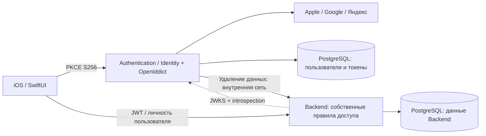

# Аутентификация и серверные резервные копии

Основа — [согласованная переписка](https://chatgpt.com/share/6aea2280-e498-83eb-be07-a822dfac1c8d): два самостоятельных .NET-приложения, ASP.NET Core Identity + OpenIddict, Google/Apple/Яндекс, PostgreSQL, Docker Compose и Authorization Code + PKCE. Добавлены регистрация/вход по email и паролю без подтверждения почты и passkey как альтернатива паролю; восстановление по почте пока не реализовано.

## Проекты

| Проект | Назначение |
| --- | --- |
| Существующий `project.yml`, `Apple/`, `Sources/` | Нативное iOS/watchOS-приложение и независимый Swift Core; пути сохранены |
| `Authentication/FitnessTracker.Authentication.csproj` | Пользователи Identity, внешние входы, OAuth/OIDC, сессии, привязки, удаление аккаунта |
| `Backend/FitnessTracker.Backend.csproj` | Backend приложения; текущая функция — резервные копии. Собственные правила доступа, JWT через discovery/JWKS и проверка отзыва через introspection Auth Server |
| `FitnessTracker.Server.sln` | Оба серверных проекта и отдельный тестовый проект `Tests/Server` |

Требуется .NET 10 SDK. Версии пакетов и lock-файлы закреплены. Внутренних ссылок между серверными проектами нет: обмен идёт по HTTP и общему документированному контракту. В production сервисы используют раздельные PostgreSQL-базы и учётные данные. SwiftData остаётся основным локальным хранилищем приложения; сервер не синхронизирует записи и не заменяет CloudKit.



## Контроллеры и сервисы

Контроллеры Authentication выполняют HTTP binding, Mapster mapping, вызов сервиса и выдачу HTTP-результата. Правило закреплено в AGENTS.md. `AccountService` управляет профилем/удалением, `PasswordService` — парольным входом/регистрацией, `PasskeyService` — WebAuthn/credentials, `ExternalLoginService` — внешними входами/привязками, `AuthorizationService` — решениями OAuth и проверкой SecurityStamp, `AppAssociationService` — конфигурацией AASA. EF/Identity операции и транзакции находятся в сервисах, которые не возвращают MVC `IActionResult`.

`Controllers/AuthenticationMapping.cs` создаёт отдельный DI `TypeAdapterConfig` Mapster 10.0.14, явно регистрирует request/command и service-data/HTTP преобразования, запрещает неявный mapping и компилирует конфигурацию при запуске. Глобальный `GlobalSettings` не меняется; используется [конфигурация экземпляра Mapster](https://github.com/MapsterMapper/Mapster/wiki/Config-instance). Публичный профиль имеет прежние поля `{id,name,createdAt,logins}`; EF entities, парольные хеши, SecurityStamp и ключевой материал не сериализуются. Владелец определяется только из проверенного principal; клиентские поля owner ID отсутствуют в командах.

MVC mapping сохраняет native principal OpenIddict, scheme и protocol errors. WebAuthn JSON передаётся Identity без повторного разбора или преобразования mapper-ом. Ожидаемые отказы сервисов преобразуются через Mapster/exception filter; инфраструктурные исключения и cancellation остаются штатному ASP.NET Core pipeline. Ошибка регистрации создаёт чистый ModelState без паролей, а безопасное сообщение неудачного входа сохраняется в browser TempData на HTTP-границе. Локальность продолжений проверяет штатный MVC URL helper в `BrowserNavigation`.

Маршруты, payloads и алгоритмы отзыва сохраняются. Backend использует собственные правила доступа вместо прикладных OAuth scopes. EF-модель и миграции не меняются; Backend сохраняет minimal API и существующий `BackupStorage`.

## Вход и сессии

Приложение открывает системную `WebAuthenticationSession` из AuthenticationServices. Auth Server предлагает email/пароль, passkey и настроенные Google/Apple/Яндекс. OpenIddict проверяет внешние OAuth/OIDC-потоки, state, nonce и ответ провайдера. Полная сборка получает код на `https://auth.example.com/ios/oauth/callback`, Personal Team — на отдельно настроенную reverse-DNS URL-схему. Каждый клиент проверяет свой точный callback, state, issuer и отсутствие повторяющихся параметров, обменивает код с PKCE S256. Client secret в iOS отсутствует. Прежние generic schemes `fitnesstracker`/`fitsession` сохраняются только для совместимости и не принимаются как OAuth callbacks.

HTTPS callback использует `.https(host:path:)` и `webcredentials` Associated Domains. Это требует настоящих App ID Prefix и Bundle ID, соответствующей capability/provisioning и файла AASA. До их настройки HTTPS-вход на iPhone не подтверждён. Для бесплатной Personal Team предусмотрен отдельный public client `fitnesstracker-ios-personal` с `.customScheme`, без Associated Domains. HTTPS client `fitnesstracker-ios` не принимает его redirect URI. [HTTPS callback Apple](https://developer.apple.com/documentation/authenticationservices/aswebauthenticationsession/callback/https(host:path:)), [custom scheme Apple](https://developer.apple.com/documentation/authenticationservices/aswebauthenticationsession/callback/customscheme%28_%3A%29).

iOS использует OAuth access/refresh tokens; профиль получает из защищённого `/v1/account`. ID token не используется как источник identity. Access token действует 10 минут, refresh — до 30 дней с ротацией. Повтор использованного refresh token отвергается и отзывает authorization family; окно повторного использования равно нулю. Параллельные iOS-запросы используют одну операцию обновления; новые токены сначала сохраняются в Keychain. При `invalid_grant` требуется новый вход. Потеря ответа token endpoint может потребовать повторного входа — автоматического повторного обмена использованного refresh нет.

Auth подтверждает личность, состояние аккаунта и сессии. iOS запрашивает только стандартные `profile offline_access`; `openid` поддерживается сервером для OIDC-клиентов. Прикладной scope `backups` больше не регистрируется и не запрашивается. Backend локально проверяет допустимый UUID в `sub`, ограничивает операции владельцем копии, применяет квоту и rate limit. Все действующие пользователи могут работать со своими копиями; дополнительных ролей или прав, выдаваемых Auth, сейчас нет. Scopes в старом токене не добавляют прав. API аккаунта требует действующий bearer token и UUID пользователя, без scope функций Backend.

Keychain item изолирован по bundle ID и issuer, не синхронизируется через iCloud, доступен при разблокированном устройстве и не переносится на другое устройство. Сетевой клиент использует HTTPS, тайм-ауты, ephemeral URLSession без cookies/cache и запрещает redirects запросов с credentials. Токены и payloads не логируются. Закрытие экрана отменяет его работу; общая операция ротации принадлежит сессии и сохраняет результат независимо от закрытия одного экрана.

Выход через прежний `/connect/revoke` отзывает текущую authorization family и все её access/refresh tokens в одной транзакции. Другой вход того же пользователя продолжает работать. Backend проверяет актуальный статус на каждом защищённом запросе: после успешного отзыва следующий запрос со старым JWT получает 401 без ожидания `exp`. Уже выполняющийся запрос автоматически не отменяется. Заблокированный Identity-пользователь не может получить новый authorization code, обменять ранее выданный код, обновить сессию или выполнить новый браузерный вход/привязку. Для удаления аккаунта сохраняется дополнительная блокировка UUID на стороне Backend.

Внешние аккаунты идентифицируются по паре provider/subject, локальные — по нормализованному email. Совпадение email не объединяет пользователей. Привязка выполняется на защищённой веб-странице из «Способы входа», с новым provider flow и проверкой текущего пользователя. Нельзя отвязать последний способ входа. Успешная отвязка в одной транзакции меняет SecurityStamp и отзывает все прежние OAuth authorizations/tokens, включая refresh и ещё не обменянные коды. Приложения на всех устройствах потребуют нового входа; текущая веб-сессия обновляется. Cookie — Secure/HttpOnly; изменяющие веб-формы защищены antiforgery. Email внешнего профиля остаётся неподтверждённым атрибутом и не даёт входа в локальный аккаунт с тем же адресом.

Версия SecurityStamp берётся из проверенной cookie и сохраняется только в защищённых code/refresh payloads. Token endpoint сверяет её с текущим пользователем. Это закрывает гонку, когда запрос проверил старую cookie до отвязки, а authorization создал после массового отзыва. Версия не публикуется в access/ID JWT. После обновления реализации старые code/refresh без этой версии отклоняются с `invalid_grant`; пользователю понадобится новый вход. Изменения схемы БД нет.

### Проверка отзыва в Backend

Сначала сохраняются прежние проверки RS256/issuer/audience/`at+jwt`/срока, затем права и per-user rate limit. До чтения body архива или вызова хранилища фильтр всей группы `/v1/backups` отправляет стандартный RFC 7662 POST на `https://AUTH_DOMAIN/connect/introspect`. JWT и отдельный `client_secret` передаются только в form body, не в URL. Backend зарегистрирован как confidential client `fitnesstracker-api` с единственным разрешением introspection; iOS остаётся public client без серверного секрета. Backend не читает БД Auth.

Положительного кеша статуса, автоматического повтора и redirects нет; тайм-аут — 5 секунд, ответ ограничен 16 KiB и требует JSON boolean `active`. `active=false` даёт 401; отказ Auth, неверный service secret, rate limit, некорректный ответ и ошибка discovery/JWKS дают 503 с `code=authentication_unavailable`. Ключи JWKS могут кешироваться независимо от статуса сессии. После восстановления Auth тот же действующий JWT снова работает; существующий iOS HTTP-клиент не очищает credentials при 503. `/health` остаётся liveness и не требует Auth.

После отвязки, удаления аккаунта или обнаруженного refresh replay следующий Backend-запрос также получает 401. OpenIddict проверяет и token entry, и authorization: это закрывает случай valid token entry, записанной после массового отзыва уже завершённой сессии. Для отдельных API такой подход предусмотрен [OpenIddict token storage](https://documentation.openiddict.com/configuration/token-storage); формат запроса/ответа описан в [RFC 7662](https://www.rfc-editor.org/rfc/rfc7662.html).

## HTTP-контракт

| Сервис / метод | URL | Назначение |
| --- | --- | --- |
| Auth GET | `/.well-known/openid-configuration` | Discovery, включая адрес JWKS |
| Auth GET | `/connect/authorize` | Authorization Code, обязательный PKCE S256, точный зарегистрированный redirect |
| Auth POST | `/connect/token` | Обмен кода / ротация refresh token; form-urlencoded |
| Auth POST | `/connect/revoke` | Стандартный запрос iOS с refresh token и публичным `client_id`; отзыв всей текущей сессии |
| Auth POST | `/connect/introspect` | RFC 7662, только confidential Backend client; внешний доступ закрыт Nginx |
| Auth GET | `/login` | Выбор включённых провайдеров |
| Auth POST | `/login/{provider}` | Начало внешнего входа / явной привязки; antiforgery |
| Auth GET/POST | `/register` | Регистрация email/пароль без подтверждения почты |
| Auth POST | `/login/password` | Парольный вход с lockout и antiforgery |
| Auth POST | `/passkeys/register/options`, `/passkeys/register` | Создание аккаунта без пароля |
| Auth POST | `/passkeys/login/options`, `/passkeys/login` | Вход по discoverable passkey |
| Auth POST | `/account/passkeys/options`, `/account/passkeys`, `/account/passkeys/remove` | Добавление/удаление своих passkey |
| Auth GET | `/.well-known/apple-app-site-association` | Webcredentials после настройки App ID |
| Auth GET/POST | `/callback/login/{provider}` | Проверенный OpenIddict callback Google/Apple/Яндекс |
| Auth GET | `/account` | Способы входа и возврат в iOS |
| Auth POST | `/account/unlink/{provider}`, `/account/logout` | Веб-действия с antiforgery |
| Auth GET | `/v1/account` | `{id,name,createdAt,logins}`; bearer token с UUID пользователя |
| Auth DELETE | `/v1/account` | Очистка копий, отзыв токенов и удаление Identity-пользователя |
| Backend GET | `/v1/backups` | Массив `{id,createdAt,archiveVersion,size,sha256}` без содержимого копий |
| Backend PUT | `/v1/backups/{uuid}` | UTF-8 архив в body; `application/vnd.fitnesstracker+json` |
| Backend GET | `/v1/backups/{uuid}` | Исходные байты архива, ETag SHA-256 |
| Backend DELETE | `/v1/backups/{uuid}` | Удаление одной собственной копии |
| Backend DELETE | `/internal/users/{uuid}/backups` | Только внутренний service credential; хостовый Nginx возвращает 404 |
| Оба GET | `/health` | Liveness процесса; не проверка подключения к БД |
| Оба GET, Development | `/openapi/v1.json` | OpenAPI-документ |

Для защищённых API нужен `Authorization: Bearer <access_token>`. Backend проверяет RS256, тип `at+jwt`, issuer, audience `fitnesstracker-api`, срок, допустимый `sub` и актуальный статус сессии через Auth. Разрешения на операции определяет сам Backend, без проверки прикладных OAuth scopes. Пользователь не передаёт owner ID в публичном API; все выборки ограничены subject токена. Чужая или отсутствующая копия возвращает одинаковый 404. При невозможности проверить статус возвращается 503, доступ к копиям закрыт. При обновлении развёртывайте изменённый iOS-клиент вместе с Auth: прежний запрос входа со scope `backups` новая регистрация клиента не принимает. Уже выданные access tokens могут использоваться до истечения срока/отзыва; scope не расширяет их права.

PUT создаёт неизменяемую копию: 201 при создании, 200 при повторе тех же байтов и UUID, 409 при попытке заменить содержимое или превышении квоты. iOS сохраняет UUID и байты неудачной загрузки до повтора, чтобы потеря ответа не создавала дубликаты. Лимит — 10 копий до 30 MiB каждая (31 457 280 байт), то есть до 300 MiB архивов на аккаунт без учёта метаданных и служебных данных PostgreSQL; старые копии не удаляются автоматически. Некорректный envelope — 400, неподдерживаемый Content-Type — 415, слишком большой body — 413, ограничение частоты — 429. PostgreSQL advisory transaction lock сериализует проверку квоты и удаление аккаунта для одного UUID. Это квота одного аккаунта: она не ограничивает суммарное хранилище при открытой регистрации новых аккаунтов.

Backend проверяет размер и envelope формата v1–v4, сохраняет JSON как bytea вместе с метаданными в одной транзакции и вычисляет SHA-256. Доменные правила повторно проверяет Swift Core перед импортом. Восстановление сначала проверяет размер/хеш, затем открывает существующий preview импорта: подтверждение обязательно, существующие UUID сохраняются, новые записи добавляются атомарно. Завершённые тренировки не изменяются обходом Core.

Копия содержит тренировки, планы и записи веса тела. Питание, изображения, HealthKit/Bluetooth-пульс, настройки и credentials не входят в существующий WorkoutArchive. Копия создаётся только по явному действию с подтверждением передачи. Она не зашифрована end-to-end: администратор сервера имеет доступ к JSON. Для сервера нужны защищённые диски/volumes и собственная политика хранения резервных копий PostgreSQL.

Удаление аккаунта сначала удаляет bytea-копии и ставит запрет на новые uploads UUID. Если Backend недоступен, Identity-пользователь остаётся и операцию можно повторить. Затем Auth в одной транзакции отзывает и удаляет токены/authorizations, включая зашифрованные session payloads, и удаляет пользователя с привязками. Backend сохраняет только UUID запрета без профиля и содержимого архивов; это защита от старых access tokens. История на iPhone и существующие копии диска/PostgreSQL администратора этим действием не удаляются. Серверные данные аккаунтов с разными UUID никогда не объединяются.

## Подготовка и развёртывание

Нужны Docker Engine + Compose на Linux, OpenSSL и Python 3 для подготовки ключей, существующий Nginx на этом же хосте, DNS двух доменов и исходящий HTTPS к провайдерам. Публичные сертификаты и их обновление настраивает администратор Nginx. В Compose постоянно работают Authentication, Backend и две PostgreSQL-базы; одноразовые `auth-storage-init` и `backend-storage-init` подготавливают права каталогов ключей перед запуском приложений.

```text
Internet → Nginx на хосте (HTTPS, ваши сертификаты)
  auth.example.com → 127.0.0.1:5080 → authentication:8080
  api.example.com  → 127.0.0.1:5081 → backend:8080
```

Compose публикует только эти loopback-порты; PostgreSQL наружу не публикуется. Значения `AUTH_HTTP_PORT`/`API_HTTP_PORT` в `.env` можно изменить вместе с соответствующими `proxy_pass` в Nginx. Домены `AUTH_DOMAIN`/`API_DOMAIN` указываются без схемы, пути и порта. Public issuer остаётся `https://AUTH_DOMAIN/`, хотя Nginx передаёт запросы внутрь по HTTP.

При первой установке:

```bash
bash scripts/setup-server.sh
# Отредактируйте .env: AUTH_DOMAIN, API_DOMAIN, HTTP-порты и credentials провайдеров.
python3 scripts/setup-server-network.py
docker compose config --quiet
docker compose up -d --build
```

Скрипт создаёт пароли БД (`AUTH_DB_PASSWORD`, `BACKEND_DB_PASSWORD`), разные ключи удаления копий и introspection, два PFX для подписи/шифрования Auth и отдельный PFX для шифрования Data Protection keys Backend. Приватные ключи Auth и Backend различаются и монтируются только в соответствующий сервис. `BACKEND_INTROSPECTION_SECRET` из `.env` передаётся только Auth и Backend как `Auth:IntrospectionClientSecret`; минимум 32 символа, генератор использует 32 случайных байта в hex. Он не совпадает с `BACKEND_SERVICE_KEY` и не передаётся iOS. Эти PFX не являются HTTPS-сертификатами Nginx; TLS-ключи в контейнеры передавать не требуется. Существующие `.env`/ключи скрипт не перезаписывает. `.env`, `.local/`, private keys и сертификаты исключены из git. `.local` доступна только владельцу, её дочерние mount-директории позволяют непривилегированному container UID читать PFX. Production использует постоянные сертификаты и зашифрованные Data Protection keys обоих сервисов; ephemeral credentials допустимы только в тестах, development certificates — в Development.

### Постоянные папки и другой диск

По умолчанию постоянные данные лежат рядом с `compose.yml`, в игнорируемой `.local/`. Именованные Docker volumes для новых установок не используются. Пути задаются в `.env`, без дополнительного Compose override:

| Переменная | Путь по умолчанию | Содержимое |
| --- | --- | --- |
| `AUTH_DB_DATA_PATH` | `./.local/auth-db` | PostgreSQL Authentication |
| `BACKEND_DB_DATA_PATH` | `./.local/backend-db` | PostgreSQL Backend, включая архивы |
| `AUTH_KEYS_PATH` | `./.local/auth-keys` | Постоянные Data Protection keys |
| `AUTH_CERTIFICATES_PATH` | `./.local/certificates` | PFX подписи/шифрования и необязательный Apple P8; mount только для чтения |
| `BACKEND_KEYS_PATH` | `./.local/backend-keys` | Постоянные Data Protection keys Backend, зашифрованные его сертификатом |
| `BACKEND_CERTIFICATES_PATH` | `./.local/backend-certificates` | Отдельный PFX шифрования Backend; mount только для чтения |

Например, для данных PostgreSQL на другом диске:

```dotenv
AUTH_DB_DATA_PATH=/srv/fitnesstracker/auth-db
BACKEND_DB_DATA_PATH=/srv/fitnesstracker/backend-db
```

Относительные пути считаются от каталога `compose.yml`; абсолютные могут указывать на другой диск. Пути с пробелами в `.env` заключайте в кавычки. Docker создаёт отсутствующие каталоги БД и Data Protection keys. Для PostgreSQL 18 монтируется родитель `/var/lib/postgresql`; фактический `PGDATA` — `18/docker` внутри выбранной папки. Базы создаются стандартным entrypoint PostgreSQL при первом запуске пустого хранилища: `fitnesstracker_auth` и `fitnesstracker_backend`, с отдельными пользователями того же имени. Backend подключается к `backend-db`; при необходимости логические имя БД и пользователь переопределяются через `BACKEND_DB_NAME` и `BACKEND_DB_USER`. Эти параметры не переименовывают уже существующую БД.

Каждый storage-init запускается без сети, с read-only root filesystem и только capabilities `CHOWN`/`FOWNER`. Он назначает своему каталогу keys UID/GID runtime-образа .NET (`APP_UID`) и mode `0700`, затем завершается. Содержимое ключей не меняется. Приложение ожидает успешного завершения своего init и работает под непривилегированным UID. Существующие каталоги сертификатов требуются заранее: `setup-server.sh` создаёт их в стандартных местах; при смене путей сначала перенесите прежние PFX/P8, сохраняя права. Отсутствующий путь сертификатов вызывает ошибку запуска. Backend в Production требует постоянный key path и сертификат шифрования; перехода на временное хранилище нет.

### Обновление защиты ключей Backend

Для сервера, подготовленного до появления отдельного Backend PFX, после обновления ветки выполните:

```bash
python3 scripts/setup-backend-keys.py
docker compose config --quiet
docker compose up -d --build
```

Команда читает существующие настройки через Compose, создаёт только недостающий Backend `encryption.pfx` по `BACKEND_CERTIFICATES_PATH` и использует прежний `CERTIFICATE_PASSWORD`. Она не меняет `.env`, PFX Auth и существующие key rings. Повторный запуск проверяет прежний PFX с заданным паролем без перезаписи; неверный пароль приводит к отказу. Сохраняется только зашифрованный PFX, временный незашифрованный PEM удаляется. Сертификат Backend также действует 730 дней и требует сохранения прежних ключей при ротации. Это шифрование служебных Data Protection keys; формат архивов и политика их хранения в PostgreSQL не меняются.

### Сообщения первого запуска

Npgsql 10 по умолчанию пробует GSSAPI/Kerberos перед обычным подключением. В минимальном Linux-образе отсутствие `libgssapi_krb5.so.2` даёт сообщение даже при входе в PostgreSQL по паролю; Npgsql обрабатывает ошибку и продолжает подключение. В обоих Dockerfile теперь устанавливается `libgssapi-krb5-2`: поддержка GSSAPI сохраняется, режим шифрования не отключается. Сама библиотека не включает Kerberos или TLS на PostgreSQL; текущий Compose использует парольное подключение внутри Docker-сети. Для внешней БД шифрование транспорта настраивается отдельно на PostgreSQL и клиенте. [Документация Npgsql](https://www.npgsql.org/doc/security.html#gss-session-encryption-gss-api).

На пустой БД Npgsql обнаруживает отсутствие `__EFMigrationsHistory` через перехватываемый SQL exception; это могло выводиться как `Failed executing DbCommand`, хотя миграции продолжались. Теперь под общей startup-блокировкой сначала вызывается штатный EF `CreateIfNotExistsAsync` для history, затем `MigrateAsync`; прочие SQL-ошибки не скрываются. Инициализация/остановка PostgreSQL во время `initdb` ожидаема. Сообщения о временном незашифрованном key ring Backend устраняются постоянным каталогом и отдельным PFX. Успех запуска проверяется `/health` и состоянием контейнеров; отдельные строки первого старта не доказывают сбой миграций.

Проверка исправления на Linux: полный `check-server.sh` прошёл, все 168 серверных тестов и пять Python-тестов сети успешны. PostgreSQL-сценарии дополнены проверкой отсутствия SQL CommandError при новом startup, отсутствия открытого master key в XML и успешной расшифровки защищённого значения после рестарта Backend с теми же PFX/key ring. Дополнительно собран runtime-образ с тем же native install, что в Dockerfile, на локальной базе .NET 10.0.0. Настоящие Auth и Backend запущены в Production с готовыми Debug-сборками, PostgreSQL 16.6 и временными сертификатами/папками: оба health 200, GSSAPI доступна, перечисленные ошибки в логах отсутствуют, key rings зашифрованы и переживают перезапуск. Это проверка runtime; полный production Compose build здесь не выполнялся. Изолированный setup/upgrade проверил PFX с custom path, права при umask 077, повторный запуск без перезаписи, отказ с неверным паролем и сохранность Auth/.env без вывода секретов. Рабочий сервер не менялся.

### Переход с прежних volumes и имён Backend

Для существующей установки сначала остановите приложения и PostgreSQL, сохраните дампы обеих БД, `.env`, Data Protection keys и token certificates. Менять путь на пустую папку без переноса данных нельзя: PostgreSQL создаст новый кластер, а не перенесёт прежний. Само обновление Compose не копирует данные и не переименовывает логическую БД.

Если использовались bind mounts, задайте в новых `AUTH_DB_DATA_PATH`/`BACKEND_DB_DATA_PATH` именно прежние пути. Если использовались именованные volumes, скопируйте их содержимое в выбранные папки при остановленных БД, сохранив UID/GID, права и всю структуру, включая `18/docker`. Каталог Data Protection keys также переносится целиком с прежними файлами и владельцем. Физический перенос допустим только между одинаковыми major-версиями PostgreSQL; между версиями используйте dump/restore. Старые volumes сохраняйте до проверки перенесённых данных.

В существующей `.env` переименуйте `BACKUP_DB_PASSWORD` в `BACKEND_DB_PASSWORD`, сохранив пароль. Если прежняя логическая БД/пользователь назывались `fitnesstracker_backups`, укажите их как параметры совместимости:

```dotenv
BACKEND_DB_NAME=fitnesstracker_backups
BACKEND_DB_USER=fitnesstracker_backups
```

Новые установки по умолчанию используют `fitnesstracker_backend`. Для существующей БД эти параметры сохраняют доступ к прежним архивам без изменения их содержимого. Из старого storage override перенесите пути в `.env`; если `COMPOSE_FILE` подключал только этот override, удалите его настройку. Если override нужен и для других изменений, переименуйте в нём сервис `backup-db` в `backend-db` и согласуйте mounts с `.env`. После переноса выполните `python3 scripts/setup-server-network.py`, `docker compose config --quiet` и `docker compose up -d --build`; проверьте аккаунт и список прежних копий. Рабочие данные агент в этой задаче не переносит и не удаляет.

### Обновление существующего сервера для introspection

Если прежняя версия ещё не использовала introspection, добавьте в существующую `.env` `BACKEND_INTROSPECTION_SECRET`, сгенерированный `openssl rand -hex 32`. Сохраните прежние пароли, PFX и Data Protection keys. Подготовьте автоматическую сеть, затем обновите свой Nginx по сгенерированному образцу ниже: доступ к `/connect/introspect` разрешён только localhost и найденной Compose subnet.

```bash
python3 scripts/setup-server-network.py
docker compose config --quiet
docker compose up -d --build
```

Обычный запуск Auth теперь применяет включённые миграции, в том числе AddPasskeys, и создаёт/обновляет регистрации clients. При смене introspection secret обновите согласованно Auth и Backend. Пока секреты расходятся, Backend закрывает доступ с 503. `--configure-clients` сохранён как необязательный служебный режим: он обновляет регистрации в существующих таблицах и завершает процесс без миграций и HTTP.

### Nginx на хосте

Шаблон — [`Config/Server/nginx.conf.example`](../Config/Server/nginx.conf.example). Команда `python3 scripts/setup-server-network.py` подставляет в него домены, HTTP-порты и настоящую подсеть Docker, записывая результат в игнорируемый `.local/nginx.generated.conf`. Устанавливайте сгенерированный файл: исходный шаблон содержит незаполненный `@SERVER_NETWORK_SUBNET@` и не подходит для прямого копирования. Конфигурация включается внутри существующего `http` context, например через `/etc/nginx/conf.d/fitnesstracker.conf`. Если оба домена покрыты имеющимся wildcard-сертификатом, его можно использовать для обоих сервисов. Например, `*.example.com` покрывает `auth.example.com`, но не `auth.fitness.example.com`. В обоих virtual hosts укажите реальные пути `ssl_certificate`/`ssl_certificate_key` к вашему текущему сертификату. Путь `/etc/nginx/ssl/example.com/` в образце условный. Сертификат настраивается оператором и не передаётся в Docker. Если HTTP→HTTPS redirect уже настроен, объедините его с существующим server block. В образце используются обычные `listen 443 ssl`, поэтому он не требует новой директивы `http2`.

```bash
# При первом подключении этих virtual hosts скопируйте сгенерированную конфигурацию.
# При обновлении перенесите изменения в существующую, сохраняя ваши TLS-пути.
sudo cp .local/nginx.generated.conf /etc/nginx/conf.d/fitnesstracker.conf
sudoedit /etc/nginx/conf.d/fitnesstracker.conf
sudo nginx -t
sudo systemctl reload nginx
```

Образец сохраняет Host и перезаписывает `X-Forwarded-Proto`/`X-Forwarded-For` значениями реального запроса. Так OpenIddict видит исходный HTTPS и корректно строит provider callbacks. Переданные клиентом forwarded headers не должны подменять эти значения. Внешний `/internal` и его подпути блокируются без учёта регистра, как и маршруты ASP.NET Core. Для Backend установлен лимит body 30 MiB (`client_max_body_size 30m`), отключена буферизация архивов во временные файлы Nginx. В уже установленной конфигурации Nginx при обновлении замените прежние `20m` на `30m`, выполните `sudo nginx -t` и `sudo systemctl reload nginx`; затем пересоберите Backend (`docker compose up -d --build backend`) и обновите iOS-приложение для приёма увеличенных архивов. Access log отключён. В Auth server block также установлен `error_log /dev/null`: при отказе upstream стандартный error log включает полный callback URI с OAuth-кодом/state. Для диагностики Auth используйте безопасные application logs и проверку доступности upstream; запросы этого virtual host в Nginx error log не сохраняются. Если нужны собственные журналы, используйте сборщик с редактированием секретных query-параметров; не включайте исходный request URI/credentials.

В обоих virtual hosts отключён `proxy_cache`. Для `/connect/introspect` задан ACL по фактическому TCP peer: localhost и автоматически найденная `SERVER_NETWORK_SUBNET`; регистр и encoded slash не обходят запрет. Клиентский `X-Forwarded-For` не даёт доступ к этому endpoint. В Auth для introspection действует отдельный общий бюджет 1200 запросов/минуту; обычный IP-лимит входа остаётся 120/минуту. Backend применяет свои 30 запросов/минуту на пользователя до удалённой проверки, поэтому отклонённые запросы не расходуют бюджет Auth.

### Автоматическая сеть Docker и доверие к proxy

`python3 scripts/setup-server-network.py` создаёт bridge-сеть без заданного IPAM-диапазона: Docker сам выбирает свободную подсеть и gateway. Скрипт считывает их через `docker network inspect`, обновляет только `SERVER_NETWORK_NAME`, `SERVER_NETWORK_SUBNET`, `SERVER_NETWORK_GATEWAY` в существующей `.env` и готовит `.local/nginx.generated.conf`. Пароли, `COMPOSE_FILE`, настройки bind mounts, PFX и volumes сохраняются. Чтение Compose учитывает `.env`, в том числе `COMPOSE_FILE=compose.yml:.local/compose.storage.yml` на Linux. Скрипт не выводит секреты, не читает `.env` как shell-код и не меняет системный Nginx.

По умолчанию сеть называется `fitness-tracker-server`; для отдельного экземпляра задайте другое `SERVER_NETWORK_NAME`. Повторная подготовка использует ту же сеть, а не выбирает новый диапазон. Чужая сеть с таким именем отклоняется. В Compose она объявлена `external`, поэтому обычный `docker compose down` её сохраняет. После переноса на другой сервер, удаления этой сети или изменения доменов/портов повторите подготовку и перенесите обновления в Nginx. При переходе со старой фиксированной сети обновляйте все сервисы через `docker compose up -d --build`, предварительно подготовив постоянные папки по разделу выше. Если свободные address pools Docker исчерпаны, скрипт завершится ошибкой, сохранив прежнюю конфигурацию; это требует настройки пула самого Docker, а не удаления БД.

Найденный gateway — адрес хоста внутри bridge и ожидаемый TCP peer у запросов от хостового Nginx через опубликованные порты. Только этот дополнительный адрес передаётся обоим приложениям как `ReverseProxy:Address`; проверка доверенного proxy сохраняется. Экспортированные устаревшие `SERVER_NETWORK_*` перекрывают `.env`, поэтому скрипт попросит выполнить соответствующий `unset`. Этот способ рассчитан на обычный Docker Engine bridge в Linux; для rootless Docker или другого сетевого режима необходимо проверить фактический peer, сохраняя loopback-привязку портов.

Backend сопоставляет `AUTH_DOMAIN` с gateway через `extra_hosts`, чтобы обращаться за discovery/JWKS и introspection к Nginx на хосте с правильными HTTPS hostname/SNI, без зависимости от hairpin-маршрутизации публичного IP. Поэтому HTTPS listener Nginx должен принимать подключения и на bridge-адресе хоста; обычный `listen 443 ssl` из образца подходит. Firewall и Nginx ACL должны разрешать этот внутренний HTTPS-доступ. Сертификат Auth должен быть доверен контейнеру: для частного CA установите доверенную цепочку в контейнер, не отключая проверку TLS. Для публичного CA используйте fullchain.

Межсервисное удаление копий остаётся в закрытой Compose-сети: Authentication вызывает `http://backend:8080/internal/...` с service key. Оно не проходит через публичный Nginx. При разнесении сервисов на разные хосты внутренний канал требует HTTPS/mTLS.

Миграции включены в проекты и применяются автоматически при обычном запуске обоих сервисов, до открытия HTTP listener. Auth после миграций создаёт/обновляет HTTPS iOS, настроенный Personal iOS и confidential Backend clients в транзакции. Вся инициализация каждого сервиса сериализована PostgreSQL advisory lock в его собственной БД: блокировка удерживается отдельным непулируемым соединением и освобождается при его закрытии, включая ошибку или завершение процесса. Повторный запуск применяет только отсутствующие миграции и сохраняет пользовательские данные. При ошибке БД/миграции/регистрации процесс завершается с ошибкой, а Compose с `restart: unless-stopped` повторяет запуск. Неготовая схема не обслуживает HTTP. SQLite-fixtures в среде `Testing` продолжают создавать изолированную схему сами.

`docker compose run --rm authentication --migrate` и аналогичная команда Backend остаются необязательными: применяют миграции и завершают процесс без HTTP. Генерацию/изменение миграций агент выполняет по правилам AGENTS.md; обычный startup использует только уже включённые в сборку миграции. Сохраняйте обе БД, каталог `AUTH_KEYS_PATH`, `.env` и token certificates при обновлениях. Срок созданных token certificates — 730 дней; ротацию выполняйте с перекрытием сроков и доступностью старого публичного ключа до истечения выданных токенов. TLS-сертификаты Nginx имеют собственный независимый lifecycle.

Проверка после настройки Nginx:

```bash
docker compose ps
curl -fsS https://auth.example.com/health
curl -fsS https://auth.example.com/.well-known/openid-configuration
curl -fsS https://api.example.com/health
docker compose logs --tail=100 authentication backend
```

Откройте `https://auth.example.com/login` и проверьте вход настроенным провайдером. `/health` подтверждает только работу процесса. Для обновления прежней Compose-конфигурации с контейнерным proxy остановите старый proxy/orphan перед передачей 80/443 хостовому Nginx; рабочие БД и volumes сохраняются.

Официальные источники: [Nginx reverse proxy](https://nginx.org/en/docs/http/ngx_http_proxy_module.html), [ASP.NET Core forwarded headers](https://learn.microsoft.com/en-us/aspnet/core/host-and-deploy/proxy-load-balancer?view=aspnetcore-10.0), [Docker port publishing](https://docs.docker.com/engine/network/port-publishing/), [автоматический IPAM Docker](https://docs.docker.com/reference/cli/docker/network/create/#specify-advanced-options), [external-сети Compose](https://docs.docker.com/reference/compose-file/networks/#external), [применение EF-миграций](https://learn.microsoft.com/en-us/ef/core/managing-schemas/migrations/applying), [PostgreSQL advisory locks](https://www.postgresql.org/docs/current/functions-admin.html#FUNCTIONS-ADVISORY-LOCKS).

## Провайдеры

Apple, Google и Яндекс всегда видны на странице входа и среди доступных привязок аккаунта. Выключенные или не полностью настроенные провайдеры показываются серыми с подсказкой «В разработке» при наведении/фокусе; на touch-устройствах пояснение видно сразу. У них нет формы отправки; прямой запрос входа также отклоняется сервером. Активной кнопка становится только при `Enabled=true` и заполненных обязательных credentials; для Apple также нужен существующий файл private key. Невалидный формат уже заданного Apple-ключа остаётся ошибкой конфигурации. Email/пароль и passkey доступны независимо от внешних провайдеров.

| Провайдер | Настройки `.env` | Redirect в кабинете провайдера |
| --- | --- | --- |
| Google | `GOOGLE_ENABLED=true`, `GOOGLE_CLIENT_ID`, `GOOGLE_CLIENT_SECRET`; Web application client | `https://AUTH_DOMAIN/callback/login/google` |
| Яндекс | `YANDEX_ENABLED=true`, `YANDEX_CLIENT_ID`, `YANDEX_CLIENT_SECRET`; доступ к ID/имени и email | `https://AUTH_DOMAIN/callback/login/yandex` |
| Apple | `APPLE_ENABLED=true`, `APPLE_CLIENT_ID` (Services ID), `APPLE_TEAM_ID`, `APPLE_KEY_ID` | `https://AUTH_DOMAIN/callback/login/apple` |

Для Apple зарегистрируйте связанный App ID, Services ID, домен и Return URL в Apple Developer. Поместите скачанный `.p8` в `.local/certificates/apple.p8`, с чтением для container UID; родительскую `.local` оставьте с mode 0700. OpenIddict создаёт client assertion из ключа Apple, provider secrets на iPhone не передаются. Проверка реального входа требует ваших registrations и доступного HTTPS-сервера; тесты их не подменяют заявлениями о готовом production-входе.

## Настройка iOS

Добавьте в существующий `Config/Local.xcconfig`, сохранив прежние Bundle ID/Team:

```xcconfig
FITNESS_TRACKER_AUTH_URL = https:/$()/auth.example.com/
FITNESS_TRACKER_BACKEND_URL = https:/$()/api.example.com/
FITNESS_TRACKER_AUTH_DOMAIN = auth.example.com
```

`$()` нужен, чтобы xcconfig не считал `//` началом комментария. `FITNESS_TRACKER_AUTH_URL` и `FITNESS_TRACKER_BACKEND_URL` — корневые HTTPS URL без credentials, query и fragment; `FITNESS_TRACKER_AUTH_DOMAIN` — только host аутентификации. Выполните `xcodegen generate`, затем сборку/тесты iOS 26 SDK по MAC_BUILD_GUIDE.md. Серверный экран доступен в «Настройки → Аккаунт и копии». Без конфигурации или при ошибке её чтения локальное приложение продолжает работать. В демо-профиле серверные действия недоступны. Вход/выход не меняет локальную историю и не включает фоновые uploads.

Перед публикацией актуализируйте App Store privacy labels и политику конфиденциальности для добровольной передачи Fitness/Health и данных аккаунта; manifest отражает связанные данные без tracking по [категориям Apple](https://developer.apple.com/documentation/bundleresources/app-privacy-configuration/nsprivacycollecteddatatypes/nsprivacycollecteddatatype).

## Email, пароль и passkey

Регистрация `/register` создаёт локальный аккаунт с email и паролем от 12 до 128 символов (не менее четырёх разных символов), либо с email и passkey без пароля. Письма и коды не отправляются; `EmailConfirmed` остаётся `false`. Адрес служит логином, но владение им не проверяется. Восстановление доступа по неподтверждённой почте не реализовано. Локальный email нормализуется Identity и получает уникальный username; совпадение email с Google/Apple/Яндекс не объединяет аккаунты. Внешние способы добавляются явным действием из аккаунта.

Пароли хеширует Identity V3 (PBKDF2-HMAC-SHA512, 210 000 итераций), пять неудачных попыток включают блокировку на 15 минут. Credential endpoints дополнительно ограничены 20 запросами в минуту на IP и защищены antiforgery. Ошибка входа не раскрывает наличие email. HTTPS cookies имеют HttpOnly, Secure и ограниченный срок; в HTML пароль не возвращается.

Passkey использует встроенный WebAuthn в ASP.NET Core Identity 10: RP ID равен точному host `Auth:Issuer`, origin должен точно совпадать с HTTPS origin issuer; cross-origin iframe запрещён. User verification и discoverable credential обязательны. Проверку подписи, challenge, RP hash, user handle, UV и счётчика выполняет Identity. Сервер хранит публичный ключ, приватный ключ остаётся у аутентификатора. Attestation `none` подходит для потребительского входа и не подтверждает модель/производителя устройства. [Документация Microsoft](https://learn.microsoft.com/en-us/aspnet/core/security/authentication/passkeys/?view=aspnetcore-10.0).

В аккаунте можно добавить до 10 passkey с названием до 64 символов и удалить свои ключи; последний доступный способ входа удалить нельзя. Удаление ключа отзывает прежние OAuth-сессии и меняет SecurityStamp. Browser JS загружается с собственного origin без inline scripts, показывает ошибки/отмену и не передаёт пароль в passkey-запросах. Требуется браузер с WebAuthn JSON API; при отсутствии поддержки доступен пароль или внешний провайдер.

Challenge живёт не более пяти минут и расходуется атомарно даже при синхронизируемом passkey с нулевым счётчиком. Ограниченный серверный cache содержит только временные challenges; перезапуск аннулирует незавершённые попытки. Текущая Compose-конфигурация запускает один Auth instance. Перед масштабированием понадобится общее атомарное хранилище challenges, а также общие Data Protection keys.

**Миграция `AddPasskeys` включена в проект.** Она добавляет `AspNetUserPasskeys`: `CredentialId` (bytea, PK), `UserId` (FK с cascade), `Data` (jsonb) и индекс `UserId`; прежние таблицы и размеры колонок сохраняются. Агент ведёт миграции по [AGENTS.md](../AGENTS.md#ef-core-и-миграции). Обычный запуск Auth автоматически применяет отсутствующие миграции до приёма HTTP. Отдельный `--migrate` доступен при необходимости предварительного обновления схемы. Рабочая БД в этой задаче не изменялась.

### Оформление браузерных страниц

Вход, регистрация и управление аккаунтом используют общий адаптивный дизайн: сиреневый фон, полупрозрачную карточку, градиентные основные кнопки и иконки способов входа. На широком экране показывается обзор функций, на узком — форма. Ненастроенные Apple/Google/Яндекс видны серыми с подсказкой «В разработке»; формы внешнего входа создаются только для полностью настроенных провайдеров, включая повторный показ регистрации после ошибки.

Шапка переключает светлую/тёмную тему и русский/английский интерфейс. Первый выбор темы следует системной настройке; явный выбор темы и языка сохраняется только в localStorage (`fitness-auth-theme`, `fitness-auth-language`). Пароли, email и OAuth credentials туда не записываются. Переключение языка не меняет URL и OAuth returnUrl. При отключённом JavaScript русские парольные формы работают, а переключатели оформления и показа пароля скрыты. Passkey требует JavaScript и прежних WebAuthn JSON API. Подсказки пароля соответствуют Identity: 12–128 символов и минимум четыре разных символа; сервер остаётся окончательным валидатором.

Скрипты и CSS загружаются с собственного origin, SVG-иконки встроены в HTML; внешних шрифтов/CDN нет. Строгая CSP сохранена. Пустая сводка ошибок Razor не рендерится, чтобы штатный скрытый `li` не добавлял запрещённый inline style. Сообщения и переводы вставляются через textContent. Локально Chromium проверил обе темы/RU/EN на 320, 393, 768 и 1440 px, отсутствие горизонтального переполнения, сохранение настроек, password toggle/confirmation, passwordless register/logout/login через настоящий WebAuthn с виртуальным authenticator и одноразовой PostgreSQL, отсутствие пароля в passkey requests и регистрацию без JavaScript. Ошибок JavaScript/CSP нет. Safari, VoiceOver и iOS WebAuthenticationSession требуют проверки на устройстве.

[Реальные браузерные скриншоты](previews/README.md#работающие-страницы-2026-11-07) сохранены в репозитории. Для обновления оформления получите изменения и пересоберите сервис:

```bash
git pull
docker compose up -d --build authentication
```

Новых EF-миграций для оформления нет; рабочие сервер и данные агент не изменял.

## Вход для бесплатной Personal Team

Схема `FitnessTracker Personal` выбирает `PersonalDebug`/`PersonalRelease` и `customScheme` callback. Схема `FitnessTracker` сохраняет HTTPS callback и требования Associated Domains. Оба варианта используют HTTPS для Auth/API, PKCE S256, те же ограничения scopes, токенов и доступа к копиям. Keychain items различаются OAuth client ID; прежний ключ HTTPS-сессии сохраняется.

Выберите reverse-DNS URL-схему под вашим контролем, например `com.example.fitnesstracker`. В `.env` сервера добавьте:

```dotenv
IOS_PERSONAL_CALLBACK_SCHEME=com.example.fitnesstracker
```

После обновления кода выполните `docker compose up -d --build authentication`. Auth зарегистрирует отдельный public client `fitnesstracker-ios-personal` с единственным redirect `com.example.fitnesstracker:/ios/oauth/callback`. Регистрация идемпотентна; отдельный `--configure-clients` не нужен. Изменений EF-модели и новых миграций нет. `IOS_APP_IDENTIFIER` для этого режима можно оставить пустым; AASA и Associated Domains нужны только HTTPS-сборке. Пустой `IOS_PERSONAL_CALLBACK_SCHEME` отключает Personal client и удаляет его прежние OAuth authorizations/tokens при следующем обычном startup; HTTPS client остаётся доступным. Пробелы и некорректная схема считаются ошибкой конфигурации.

На Mac добавьте в существующий `Config/Local.xcconfig`, сохранив Team/Bundle ID и HTTPS URL серверов:

```xcconfig
FITNESS_TRACKER_AUTH_CALLBACK_SCHEME = com.example.fitnesstracker
```

Значение должно точно совпадать с серверным. По умолчанию схема берётся из `FITNESS_TRACKER_BUNDLE_ID`. После этого выполните `xcodegen generate`, откройте `FitnessTracker.xcodeproj` и запустите `FitnessTracker Personal`. Генерация обязательна после этого обновления: изменились build settings и регистрация URL-схемы в Info.plist. Параметр `FITNESS_TRACKER_AUTH_CALLBACK_MODE` выбирается схемой сборки; автоматического перехода с HTTPS на private-use URI при ошибке нет. Отмена браузера показывает нейтральное сообщение «Вход в аккаунт не завершён.», а отменённая задача закрытого экрана не публикует устаревшие ошибки.

Private-use URI предусмотрены [RFC 8252](https://www.rfc-editor.org/rfc/rfc8252.html#section-7.1). Они не доказывают связь приложения с доменом: другое приложение может зарегистрировать такую же схему. PKCE защищает обмен перехваченного code, но не является подтверждением подлинности приложения. Поэтому режим включается явно на сервере, имеет отдельный client ID и не расширяет разрешённые callbacks HTTPS client. Не используйте generic schemes `fitnesstracker`/`fitsession` и не передавайте токены в callback URL.

Проверки Personal Team на Linux: полный `check-server.sh` — 190 сценариев, включая 13 PostgreSQL 16.6; отдельный introspection-сценарий подтвердил немедленный `active=false` у ранее выданного access token после отключения клиента. Проверены точный redirect, обязательный S256, неверный verifier, replay, cross-client code/refresh, revoke, invalid schemes и обновление/отключение регистрации при Production startup. Swift 6.2.1: 212 Core-тестов и portable account checks с настоящими URLSession HTTP fixtures, без внешней сети и Apple SDK; проверены выбор клиента на всех этапах, callback/state/issuer, конфигурация, повтор после отмены, syntax/lint/resources/localizations. Новые EF-миграции не требуются, рабочий сервер не менялся. Реальный браузер, signing и возврат в iOS требуют проверки на устройстве.

## Привязка HTTPS callback к iOS

В `.env` оставьте `IOS_APP_IDENTIFIER` пустым до регистрации приложения. После получения App ID укажите `AppIDPrefix.BundleID`, например формат `ABCDEFGHIJ.ru.yourcompany.fitnesstracker` (пример, не готовый идентификатор). Используйте именно App ID Prefix из Apple, который не всегда равен Team ID. Затем пересоздайте Auth container с новым env и проверьте `https://auth.example.com/.well-known/apple-app-site-association`: JSON `webcredentials.apps` должен содержать ваш настоящий App ID. До настройки endpoint отвечает 404, при неверном формате — 503; редиректа и публикации вымышленных ID нет.

Главный target в полной схеме `FitnessTracker` содержит `webcredentials:$(FITNESS_TRACKER_AUTH_DOMAIN)`. Пример значения — `auth.example.com`; реальный host задайте только в игнорируемом `Config/Local.xcconfig` через `FITNESS_TRACKER_AUTH_DOMAIN`, согласованно с `FITNESS_TRACKER_AUTH_URL`. В Apple Developer включите Associated Domains для App ID и обновите provisioning. Personal Team схема сохраняет прежние entitlements и использует отдельный private-use callback; HTTPS-вход проверяйте в полной схеме с настроенной capability. Bundle ID совместимости не переименовывается автоматически. В `Config/Local.xcconfig` задайте выбранные HTTPS endpoints, как в примере выше. При смене домена согласованно измените локальный `FITNESS_TRACKER_AUTH_DOMAIN`, `Auth:Issuer`, redirect URI и серверные URL. Реальные адреса не нужно записывать в tracked-файлы. Выполните `--configure-clients`, чтобы заменить прежний redirect URI в существующей Auth-БД; старые уже выданные коды могут потребовать нового входа.

Файл AASA и DNS/TLS должны быть доступны публично для Apple. Запись DNS-01, используемая при выдаче сертификата, сама не создаёт A/AAAA-записи сервисов: направьте оба настроенных имени на сервер. Nginx использует ваш настроенный сертификат. Возврат в приложение, browser passkey, отмена и повтор входа требуют отдельной проверки на настоящем iPhone после настройки Apple ID.

## Проверка безопасности 2026-11-04

Проверены серверные исходники, OAuth/Identity и JWT middleware, границы доступа к копиям, транзакции удаления, Compose/Nginx и NuGet-зависимости. Результат аудита и последующей доработки отзыва:

| Приоритет | Проблема | Исправление и подтверждение |
| --- | --- | --- |
| Высокий | Отвязка провайдера не отзывала OAuth-сессии: ранее выданный refresh продолжал давать доступ после отключения способа входа; начатая до отвязки выдача кода могла обойти массовый отзыв | Отзыв authorizations/tokens в транзакции удаления login и привязка code/refresh к stamp проверенной cookie; HTTP-тесты старых токенов, запрета последней отвязки и детерминированной гонки; PostgreSQL проверяет сохранённые статусы |
| Высокий | Backend принимал JWT отозванной сессии до истечения `exp` | Локальная проверка JWT сохранена; перед каждым доступом к копиям — uncached introspection. Logout атомарно отзывает текущую family. Сквозные тесты проверяют 401 после revoke/unlink/delete/replay и 503 при отказе Auth |
| Средний | OpenIddict завершал анонимные запросы до `UseRateLimiter`, обходя IP-лимит Auth | Лимит перенесён перед authentication middleware; после 120 запросов authorize/token/discovery следующий получает 429 |
| Средний | При 502 Nginx записывал OAuth code/state в унаследованный error log | В Auth virtual host отключена запись исходных ошибок Nginx; изолированная проверка 502 с синтетическим callback больше не находит code/state в журнале |

Backend отклоняет JWT с неверными issuer/audience/type/subject, чужой подписью, без подписи, с HS256 вместо RS256, без exp, истёкшие и ещё не вступившие в силу. Проверены чтение/запись чужих копий, внутренний service credential, идемпотентность, квота и сохранность данных при отказах; PostgreSQL-сценарии отдельно проверяют конкуренцию. Права локальны для Backend: JWT без scopes разрешает работу только со своими данными, а произвольные scopes не открывают чужие. Поддельные forwarded headers от неизвестного peer не подтверждают HTTPS. Веб-формы используют antiforgery, return URL ограничен локальным адресом, одинаковый email не объединяет аккаунты.

`dotnet package list --project FitnessTracker.Server.sln --vulnerable --include-transitive --no-restore --format json` завершился успешно с источником NuGet.org и не сообщил об известных уязвимостях в трёх проектах. [Advisory OpenIddict GHSA-925x-4h4v-2792](https://github.com/openiddict/openiddict-core/security/advisories/GHSA-925x-4h4v-2792) исправлен с 7.7; используемая 7.7.2 находится вне затронутого диапазона.

Остаются границы проверки и эксплуатационные риски:

- Проверка отзыва делает защищённые операции зависимыми от доступности Auth. Ошибка даёт 503 с сохранением credentials; уже начатые до отзыва запросы автоматически не отменяются. Удаление аккаунта дополнительно блокирует новые PUT через tombstone.
- Частота запросов и квота действуют на пользователя, но общего лимита одновременно обрабатываемых больших архивов нет. Перед открытием публичного сервера нужны лимиты соединений в хостовом Nginx и бюджеты памяти/диска под фактическую нагрузку; устойчивость к распределённому DoS не проверялась.
- Копии доступны администратору БД; шифрование дисков и резервных копий PostgreSQL настраивается на сервере. Текущий Compose использует bootstrap role также для приложения, а `POSTGRES_USER` создаётся с superuser-правами по [контракту официального образа](https://hub.docker.com/_/postgres). Для production разделите роли миграций и обычного DML-доступа; права существующих рабочих БД в этой проверке не менялись.
- HTTPS callback реализован с Associated Domains; старый custom scheme отклоняется. До настройки настоящего Apple App ID и проверки provisioning/AASA на устройстве публикация iOS-входа не завершена.
- Реальные DNS/TLS, вход Google/Apple/Яндекс, конфигурация вашего Nginx, ОС и содержимое production Docker images не проверялись.

Порядок middleware учитывает [интеграцию OpenIddict через IAuthenticationRequestHandler](https://documentation.openiddict.com/integrations/aspnet-core) и [правила ASP.NET Core pipeline](https://learn.microsoft.com/en-us/aspnet/core/fundamentals/middleware/?view=aspnetcore-10.0).

## Повторная проверка безопасности 2026-11-07

Проверены текущие исходники и публичные Auth/API без входа, создания аккаунтов или изменения рабочих данных. 30 анонимных HTTP-проверок дали ожидаемые ответы: API без действительного bearer — 401; внешний introspection — 403 даже с поддельным X-Forwarded-For; internal prefix — 404, включая другой регистр и кодированный разделитель. Секретные конфигурации, сертификаты и production OpenAPI не доступны по проверенным путям. Проверены antiforgery в формах, локальный return URL, CSP, no-store, nosniff и HSTS. Дополнительно discovery/JWKS публикуют только публичные ключи и S256; authorize без входа не выдаёт код, неверный redirect, plain PKCE и отсутствие PKCE отвергаются.

Оба HTTPS-хоста прошли проверку сертификата и TLS 1.3, TLS 1.2 не принимался; HTTP перенаправлялся на HTTPS. Это проверка наблюдаемого ответа, а не подтверждение всей конфигурации ОС, firewall и каждого virtual host. Доступность PostgreSQL и HTTP-портов контейнеров извне не подтверждена: TCP-соединение само по себе не доказывает доступ к сервису, протокольные пробы не получили ответа HTTP/PostgreSQL.

Свежая проверка NuGet.org не сообщила об известных уязвимых direct/transitive packages трёх проектов. Она не проверяет базовые OS packages и фактически развёрнутый runtime. По предоставленному выводу Backend использует Microsoft.NETCore.App/Microsoft.AspNetCore.App 10.0.14 — версию с [security fixes Microsoft от 25 октября](https://github.com/dotnet/core/blob/main/release-notes/10.0/10.0.14/10.0.14.md); версия работающего Authentication отдельно не подтверждена. Локально полный check-server прошёл: 191 xUnit-сценарий (73 unit, 105 HTTP/Identity/SQLite, 13 PostgreSQL 16.6), без warnings/errors, форматирование и пять Python-тестов сети.

В проверенном объёме обход аутентификации или доступа к чужим копиям не обнаружен. Остаются следующие риски и ограничения:

- Квота 10 × 30 MiB ограничивает архивы одного аккаунта, но при открытой регистрации не ограничивает общий диск. Нужны общий бюджет хранения и контроль злоупотребления регистрацией, если сервер открывается для посторонних пользователей.
- Rate limit ограничивает число запросов за минуту; общего лимита одновременных upload/объёма памяти нет. Upload буферизуется в памяти, поэтому параллельные большие архивы могут исчерпать RAM. Нагрузочный DoS-тест рабочего сервера не выполнялся.
- Новый opt-in Personal client использует custom scheme с PKCE. Это позволяет вход бесплатной Personal Team, но не подтверждает принадлежность приложения домену; PKCE защищает от перехвата чужого кода, а не от приложения, начавшего собственный вход от имени public client. Для распространения предпочтителен существующий HTTPS callback с Associated Domains; [RFC 8252, разделы 8.1 и 8.6](https://www.rfc-editor.org/rfc/rfc8252) объясняет это ограничение.
- Подтверждения email по согласованному требованию нет: адрес не доказывает владение почтой. Совпадающие адреса по-прежнему не объединяют аккаунты автоматически.
- Копии не имеют end-to-end шифрования; защита диска и резервных копий PostgreSQL остаётся задачей развёртывания. Разделение bootstrap/migration и DML-ролей БД, состояние ОС, firewall, production OS packages и все реальные provider/passkey flows этой проверкой не подтверждены.

## Проверки

После переноса логики контроллеров в сервисы полный `check-server.sh` прошёл: locked restore с Mapster 10.0.14, сборка без warnings/errors, 154 сценария (70 unit, 78 HTTP/Identity/SQLite, 6 PostgreSQL 16.6), проверка `dotnet format` и shell syntax. Новые проверки подтверждают зависимости тонких контроллеров, запрет неявного Identity entity mapping, сохранение native OAuth principal/stamp/grant/error, защиту от overposting, точный JSON профиля и безопасное PRG/TempData сообщение. Прежние PKCE, refresh/revoke, WebAuthn, race/rollback и межсервисные сценарии повторно прошли. EF-модель и миграции не менялись; рабочие базы не использовались.

После замены адресов развёртывания примерами: 21 OAuth/Identity/forwarded-HTTPS/AASA тест прошёл, Compose и изолированный Nginx syntax/ACL/header smoke проверены. Associated Domains использует локально переопределяемый host; структура проекта и plist проверены, signing/Apple SDK требуют Xcode.

После добавления email/passkey и HTTPS callback полный `check-server.sh` прошёл: locked restore, сборка .NET без warnings, 149 сценариев (67 unit, 76 HTTP/Identity/SQLite, 6 PostgreSQL 16.6), `dotnet format` и shell syntax. Новые проверки используют реальную WebAuthn ES256 подпись через штатный Identity; проверены неверные RP/origin/UV/подпись, CSRF, lockout, replay, добавление/удаление ключа, отзыв grant, last-credential guard и AASA. Отдельный model-diff тест подтверждает единственную новую таблицу/индекс без сужения прежних колонок. Миграция `AddPasskeys` и snapshot созданы штатным EF Core; повторная PostgreSQL-проверка подтвердила обновление прежней схемы с данными, сохранность password/login/длинных полей, JSONB round-trip/update/cascade, а также прежние migration/concurrency/rollback сценарии. Использовался одноразовый PostgreSQL 16.6 с отдельными случайными БД; рабочая база не менялась. После финального просмотра повторно прошли 13 целевых credential/schema тестов: password-попытки не блокируют passkey-only аккаунт, challenge одноразовый и при нулевом счётчике, пустой ID удаления даёт 400; snapshot согласован с миграцией.

Compose проверен на примерах доменов/HTTPS callback/пустом App ID и loopback ports. Nginx 1.24 повторно прошёл syntax/ACL/forwarded headers smoke с тестовым TLS, без изменения хостового Nginx или настоящих сертификатов. Swift-format strict lint, структура/plist, JS syntax и diff проверены. Полного Swift SDK нет; доступного места недостаточно для его установки. Новые Apple XCTest, Core build/tests, Apple SDK и устройство в этой сессии не запускались.

Локально 2026-11-04 после внедрения introspection: полный `check-server.sh` прошёл — locked restore, сборка без warnings, 131 сценарий (66 unit, 60 HTTP/Identity/SQLite, 5 PostgreSQL 16.6) и `dotnet format`. Сквозные сценарии используют настоящие Auth/Backend, PKCE, discovery/JWKS и introspection: без кеша статуса, немедленный отказ после logout/unlink/delete/replay, изоляция другого входа, отказ Auth с кешем metadata и при холодном старте, восстановление с прежним JWT. Отдельно проверены ошибки HTTP/JSON/encoding, размер ответа, отмена, startup validation и rate limit до удалённой проверки. PostgreSQL проверяет commit/rollback logout с сохранением второй сессии. Тесты гонок используют сигналы, без фиксированных задержек. PostgreSQL запускался одноразовым контейнером с динамическим localhost-портом и отдельными временными БД. Схема и файлы миграций не менялись.

Compose config повторно проверен с обычными и изменёнными портами/subnet/gateway и согласованным новым секретом Auth/Backend. Изолированный запуск setup подтвердил пять разных 256-bit секретов, mode 0600 `.env` и сохранение прежних ключей при повторе. Nginx 1.24 прошёл `nginx -t` и smoke: introspection разрешена доверенному peer, запрещена постороннему при поддельном XFF/разном регистре/кодировании, обычный login и запрет `/internal` сохранены. Ранее Docker-upstream подтвердил TCP peer bridge gateway, а сценарий 502 — отсутствие code/state в error log. Использовались временные локальные порты и тестовый TLS-сертификат. Системный Nginx не устанавливался и не изменялся. Эта проверка не заменяет проверку ваших доменов, сертификатов и полного provider flow на сервере.

Ранее проверены Swift-format 6.2.1 strict lint, структура, RU/EN и ресурсы. Core build/tests, Apple SDK/XCTest, production images и реальные provider flows не запускались.

```bash
bash scripts/check-server.sh
dotnet tool restore
dotnet ef migrations has-pending-model-changes --project Authentication
dotnet ef migrations has-pending-model-changes --project Backend
```

Наборы находятся в одном xUnit-проекте; категории позволяют запускать их отдельно:

| Категория | Исходники | Что проверяется |
| --- | --- | --- |
| `Unit` | `Tests/Server/BackupArchiveValidatorTests.cs` | v1–v4 и legacy format, обязательные поля, неверные JSON-типы/UTF-8, точные границы байтов и количества записей, безопасные ошибки; без БД и HTTP |
| `Unit` | `Tests/Server/BackupCleanupTests.cs` | DELETE/service key контракт, ошибки статуса и конфигурации, передача отмены в HTTP handler без сети |
| `Unit` | `Tests/Server/TokenIntrospectionTests.cs` | RFC 7662 POST/body, active boolean, protocol/HTTP/transport errors, ограничение ответа, отмена, отсутствие утечек секретов |
| `Unit` | `Tests/Server/AuthenticationMappingTests.cs` | Зависимости тонких контроллеров, запрет неявного Identity entity mapping, сохранение principal/stamp/grant и OAuth error при HTTP mapping |
| `Unit` / `HTTP` | `Tests/Server/ProviderSelectionTests.cs` | Полнота credentials, серые кнопки и доступные tooltip для ненастроенных способов, запрет прямого POST, сохранение активного входа и привязки настроенного провайдера |
| `HTTP` | `Tests/Server/AuthenticationMappingHttpTests.cs` | Защита от overposting, точный публичный профиль после настоящего OAuth exchange, безопасное сообщение PRG/TempData без credentials в HTML |
| `Unit` | `Tests/Server/PasskeySchemaTests.cs` | Согласованность snapshot и модели, AddPasskeys добавляет только таблицу/индекс, прежние колонки не сужаются |
| `HTTP` | `Tests/Server/CredentialsTests.cs` | Email/password без подтверждения, нормализация/уникальность, CSRF, lockout, отсутствие email merge, реальные WebAuthn attestation/assertion, origin/RP/UV/signature/replay, управление ключами и отзыв |
| `HTTP` | `Tests/Server/AppAssociationTests.cs` | AASA только с настроенным App ID, безопасный HTTPS fallback без отражения code/state |
| `HTTP` | `Tests/Server/BackendTests.cs` | JWT/subject и изоляция пользователей без scopes, отсутствие дополнительных прав от scopes в токене, MIME type, SHA-256/headers/фиксированное время, квота, идемпотентность, откат при отказе/отмене записи |
| `HTTP` | `Tests/Server/AuthenticationTests.cs` | PKCE, code/refresh/revoke, блокировка аккаунта, scopes, prompt=none, antiforgery, внешние привязки, отзыв сессий/гонка отвязки и удаление данных |
| `HTTP` | `Tests/Server/AuthenticationSecurityTests.cs` | IP-лимит OAuth errors/discovery применяется до обработки запросов OpenIddict |
| `HTTP` | `Tests/Server/BackendSecurityTests.cs` | Запрет unsigned/HS256 JWT, обязательный exp и запрет преждевременного использования токена |
| `HTTP` | `Tests/Server/HostNginxForwardingTests.cs` | Исходный HTTPS за доверенным proxy, отказ поддельному `X-Forwarded-Proto` от чужого peer, IPv4 и IPv4-mapped IPv6 |
| `HTTP` | `Tests/Server/BackendIntrospectionTests.cs` | Отсутствие positive cache, 401/503 и сохранность данных, recovery с прежним JWT, rate limit до обращения к Auth, startup validation |
| `HTTP` | `Tests/Server/SessionRevocationTests.cs` | Настоящие два host, discovery/JWKS и introspection, logout одной сессии/ротации, unlink/delete/replay, revoked grant при valid token entry, Auth outage с кешем и без кеша metadata, server credentials/audience |
| `PostgreSQL` | `Tests/Server/PostgresTests.cs` | Раздельные БД Auth/Backend, существующие миграции и model snapshots, конкурентная квота, гонка PUT/удаления и сохранность чужих данных, отзыв при отвязке и атомарный logout/rollback с сохранением другой сессии; AddPasskeys поверх прежних данных и JSONB round-trip/update/cascade |
| `PostgreSQL` | `Tests/Server/StartupMigrationTests.cs` | Настоящий Production startup без --migrate на пустой и прежней схеме, сохранность аккаунтов/архивов/clients при повторе, обновление secret, отказ запуска при ошибке миграции, два конкурирующих Auth с наблюдаемой блокировкой PostgreSQL |
| Python / fake Docker | `Tests/Scripts/test_server_network.py` | Автоматический IPAM без фиксированного CIDR, повторная подготовка, сохранность credentials/COMPOSE_FILE, чужая сеть, исчерпание пула, устаревший export и безопасная генерация Nginx |

```bash
dotnet test FitnessTracker.Server.sln --no-build --no-restore -m:1 --filter 'Category=Unit'
dotnet test FitnessTracker.Server.sln --no-build --no-restore -m:1 --filter 'Category=HTTP'
```

Обычный прогон не вызывает внешних OAuth-провайдеров. HTTP fixtures используют настоящий in-memory host и собственную SQLite, очищают пользовательские configuration sources, явно отключают внешние providers и внедряют фиксированное время для метаданных. Отказ/отмена SaveChanges подменяются через EF interceptor, сохраняя настоящую транзакцию и проверки результата. Сценарии и вспомогательные классы имеют XML-описания на русском языке.

Для PostgreSQL задайте `FITNESS_TRACKER_TEST_POSTGRES` connection string к **одноразовому тестовому экземпляру** и запустите `check-server.sh`; он включит все 12 PostgreSQL-проверок. Только эту категорию запускают с `--filter 'Category=PostgreSQL'`. Без явной конфигурации прямой запуск категории завершается ошибкой, а не молчаливым пропуском. Fixture создаёт случайные отдельные базы с отключённым pooling и удаляет только их с отдельным cleanup deadline, включая сбой основного теста. Триггер отказа записи существует только в случайной тестовой БД сценария rollback. CI поднимает PostgreSQL 18; локально проверено на 16.6, на динамически выделенном localhost-порту. Файлы миграций для этих тестов не генерируются и не изменяются.

После автоматизации развёртывания локально прошёл полный `check-server.sh`: locked restore, сборка без warnings/errors, 166 xUnit-сценариев (73 unit, 81 HTTP/Identity/SQLite, 12 PostgreSQL 16.6), `dotnet format` и пять Python-тестов скрипта сети. Отдельная проверка с настоящим Docker подтвердила автоматическое выделение свободной подсети, повторную подготовку без смены network ID, сохранение storage override и сети после `compose down`, согласованные proxy/extra_hosts и фактический HTTP peer gateway. Временный Nginx прошёл syntax/ACL/header и проверку отсутствия OAuth query в error log при 502. Production startup проверен с тестовыми PFX и БД через настоящий Main; рабочий сервер и его сертификаты не менялись. Визуальная проверка подсказок в браузере на реальных устройствах не выполнялась.

2026-11-05 после переноса хранения и правил доступа полный `check-server.sh` прошёл: 168 xUnit-сценариев (73 unit, 83 HTTP/Identity/SQLite, 12 PostgreSQL 16.6), locked restore, сборка без warnings/errors, форматирование и пять Python-тестов сети. HTTP-проверки используют токены без scope функций Backend; отдельно проверено, что scopes в токене не открывают чужие копии. Сквозные проверки PKCE, introspection и немедленного отзыва сохранены. Временные Docker Compose проекты проверили пути по умолчанию и абсолютные пути с пробелами, согласованность имён БД/пользователя с connection string, запись keys под UID 1654 без capabilities, повторный init и сохранность БД/ключей после пересоздания контейнеров. Storage smoke использовал локальные PostgreSQL 16.6 с явным `PGDATA` и runtime .NET 10.0.0; сборка production images и запуск PostgreSQL 18 в этой проверке не выполнялись. Изолированный setup подтвердил пять разных 256-bit секретов, mode 0600 `.env` и сохранение ключей при повторе. Swift-format изменённых файлов прошёл; новый XCTest OAuth query требует Xcode. Рабочие базы, папки и конфигурация сервера не менялись.

Apple XCTest `AccountBackupTests` проверяют callback validation, одну ротацию для параллельных запросов, ошибки сети/Keychain, истёкшую сессию и проверку целостности; `ArchiveTransferTests` проверяет подтверждение восстановления. Их запуск требует Xcode. Foundation-часть добавлена в Swift 6 type-check скрипта `check-linux.sh`; SwiftUI/Keychain/CryptoKit и реальный вход требуют Apple SDK/устройства. Чек-лист: [XCODE_VALIDATION.md](XCODE_VALIDATION.md).

Официальные источники: [OpenIddict ASP.NET Core](https://documentation.openiddict.com/integrations/aspnet-core), [Web providers](https://documentation.openiddict.com/integrations/web-providers), [пример Velusia](https://github.com/openiddict/openiddict-samples/tree/dev/samples/Velusia), [Apple WebAuthenticationSession](https://developer.apple.com/documentation/authenticationservices/webauthenticationsession), [Google OIDC](https://developers.google.com/identity/openid-connect/openid-connect), [Яндекс ID](https://yandex.ru/dev/id/doc/ru/), [Sign in with Apple](https://developer.apple.com/documentation/signinwithapplerestapi).
