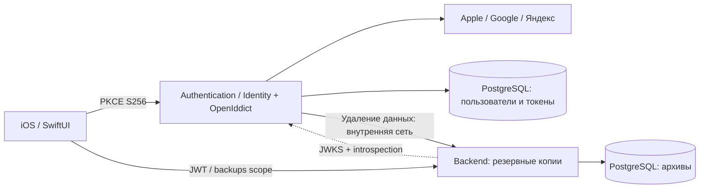

# Аутентификация и серверные резервные копии

Основа — [согласованная переписка](https://chatgpt.com/share/6aea2280-e498-83eb-be07-a822dfac1c8d): два самостоятельных .NET-приложения, ASP.NET Core Identity + OpenIddict, Google/Apple/Яндекс, PostgreSQL, Docker Compose и Authorization Code + PKCE. Email-вход остаётся следующим этапом: Identity уже поддерживает пароли, но публичных email register/login/reset endpoints пока нет.

## Проекты

| Проект | Назначение |
| --- | --- |
| Существующий `project.yml`, `Apple/`, `Sources/` | Нативное iOS/watchOS-приложение и независимый Swift Core; пути сохранены |
| `Authentication/FitnessTracker.Authentication.csproj` | Пользователи Identity, внешние входы, OAuth/OIDC, сессии, привязки, удаление аккаунта |
| `Backend/FitnessTracker.Backend.csproj` | Только резервные копии; JWT через discovery/JWKS и проверка отзыва через introspection Auth Server |
| `FitnessTracker.Server.sln` | Оба серверных проекта и отдельный тестовый проект `Tests/Server` |

Требуется .NET 10 SDK. Версии пакетов и lock-файлы закреплены. Внутренних ссылок между серверными проектами нет: обмен идёт по HTTP и общему документированному контракту. В production сервисы используют раздельные PostgreSQL-базы и учётные данные. SwiftData остаётся основным локальным хранилищем приложения; сервер не синхронизирует записи и не заменяет CloudKit.



## Вход и сессии

Приложение открывает системную `WebAuthenticationSession` из AuthenticationServices. Auth Server показывает русскую страницу выбора доступных провайдеров. OpenIddict Client выполняет и проверяет внешние OAuth/OIDC-потоки, state, nonce и ответ провайдера. Для каждого провайдера используется отдельный callback. Приложение получает одноразовый код на `fitnesstracker://oauth/callback`, проверяет точный URL и state, обменивает код с PKCE S256; client secret в iOS отсутствует. Схема callback уже зарегистрирована приложением. При необходимости можно согласованно перейти на HTTPS callback и Associated Domains; готового AASA для неизвестного домена здесь нет.

iOS использует OAuth access/refresh tokens; профиль получает из защищённого `/v1/account`. ID token не используется как источник identity. Access token действует 10 минут, refresh — до 30 дней с ротацией. Повтор использованного refresh token отвергается и отзывает authorization family; окно повторного использования равно нулю. Параллельные iOS-запросы используют одну операцию обновления; новые токены сначала сохраняются в Keychain. При `invalid_grant` требуется новый вход. Потеря ответа token endpoint может потребовать повторного входа — автоматического повторного обмена использованного refresh нет.

Keychain item изолирован по bundle ID и issuer, не синхронизируется через iCloud, доступен при разблокированном устройстве и не переносится на другое устройство. Сетевой клиент использует HTTPS, тайм-ауты, ephemeral URLSession без cookies/cache и запрещает redirects запросов с credentials. Токены и payloads не логируются. Закрытие экрана отменяет его работу; общая операция ротации принадлежит сессии и сохраняет результат независимо от закрытия одного экрана.

Выход через прежний `/connect/revoke` отзывает текущую authorization family и все её access/refresh tokens в одной транзакции. Другой вход того же пользователя продолжает работать. Backend проверяет актуальный статус на каждом защищённом запросе: после успешного отзыва следующий запрос со старым JWT получает 401 без ожидания `exp`. Уже выполняющийся запрос автоматически не отменяется. Заблокированный Identity-пользователь не может получить новый authorization code, обменять ранее выданный код, обновить сессию или выполнить новый браузерный вход/привязку. Для удаления аккаунта сохраняется дополнительная блокировка UUID на стороне Backend.

Аккаунты идентифицируются по паре provider/subject, а не email. Совпадение email не объединяет пользователей. Привязка выполняется на защищённой веб-странице из «Способы входа», с новым provider flow и проверкой текущего пользователя. Нельзя отвязать последний способ входа. Успешная отвязка в одной транзакции меняет SecurityStamp и отзывает все прежние OAuth authorizations/tokens, включая refresh и ещё не обменянные коды. Приложения на всех устройствах потребуют нового входа; текущая веб-сессия обновляется. Cookie — Secure/HttpOnly; изменяющие веб-формы защищены antiforgery. Email используется только как атрибут внешнего профиля и не считается подтверждённым для будущего password-входа.

Версия SecurityStamp берётся из проверенной cookie и сохраняется только в защищённых code/refresh payloads. Token endpoint сверяет её с текущим пользователем. Это закрывает гонку, когда запрос проверил старую cookie до отвязки, а authorization создал после массового отзыва. Версия не публикуется в access/ID JWT. После обновления реализации старые code/refresh без этой версии отклоняются с `invalid_grant`; пользователю понадобится новый вход. Изменения схемы БД нет.

### Проверка отзыва в Backend

Сначала сохраняются прежние проверки RS256/issuer/audience/`at+jwt`/срока, затем права и per-user rate limit. До чтения body архива или вызова хранилища фильтр всей группы `/v1/backups` отправляет стандартный RFC 7662 POST на `https://AUTH_DOMAIN/connect/introspect`. JWT и отдельный `client_secret` передаются только в form body, не в URL. Backend зарегистрирован как confidential client `fitnesstracker-api` с единственным разрешением introspection; iOS остаётся public client без серверного секрета. Backend не читает БД Auth.

Положительного кеша статуса, автоматического повтора и redirects нет; тайм-аут — 5 секунд, ответ ограничен 16 KiB и требует JSON boolean `active`. `active=false` даёт 401; отказ Auth, неверный service secret, rate limit, некорректный ответ и ошибка discovery/JWKS дают 503 с `code=authentication_unavailable`. Ключи JWKS могут кешироваться независимо от статуса сессии. После восстановления Auth тот же действующий JWT снова работает; существующий iOS HTTP-клиент не очищает credentials при 503. `/health` остаётся liveness и не требует Auth.

После отвязки, удаления аккаунта или обнаруженного refresh replay следующий Backend-запрос также получает 401. OpenIddict проверяет и token entry, и authorization: это закрывает случай valid token entry, записанной после массового отзыва уже завершённой сессии. Для отдельных API такой подход предусмотрен [OpenIddict token storage](https://documentation.openiddict.com/configuration/token-storage); формат запроса/ответа описан в [RFC 7662](https://www.rfc-editor.org/rfc/rfc7662.html).

## HTTP-контракт

| Сервис / метод | URL | Назначение |
| --- | --- | --- |
| Auth GET | `/.well-known/openid-configuration` | Discovery, включая адрес JWKS |
| Auth GET | `/connect/authorize` | Authorization Code, обязательный PKCE S256, точный зарегистрированный redirect |
| Auth POST | `/connect/token` | Обмен кода / ротация refresh token; form-urlencoded |
| Auth POST | `/connect/revoke` | Стандартный запрос iOS с refresh token и публичным `client_id`; отзыв всей текущей сессии |
| Auth POST | `/connect/introspect` | RFC 7662, только confidential Backend client; внешний доступ закрыт Nginx |
| Auth GET | `/login` | Выбор включённых провайдеров |
| Auth POST | `/login/{provider}` | Начало внешнего входа / явной привязки; antiforgery |
| Auth GET/POST | `/callback/login/{provider}` | Проверенный OpenIddict callback Google/Apple/Яндекс |
| Auth GET | `/account` | Способы входа и возврат в iOS |
| Auth POST | `/account/unlink/{provider}`, `/account/logout` | Веб-действия с antiforgery |
| Auth GET | `/v1/account` | `{id,name,createdAt,logins}`; bearer token, scope `backups` |
| Auth DELETE | `/v1/account` | Очистка копий, отзыв токенов и удаление Identity-пользователя |
| Backend GET | `/v1/backups` | Массив `{id,createdAt,archiveVersion,size,sha256}` без содержимого копий |
| Backend PUT | `/v1/backups/{uuid}` | UTF-8 архив в body; `application/vnd.fitnesstracker+json` |
| Backend GET | `/v1/backups/{uuid}` | Исходные байты архива, ETag SHA-256 |
| Backend DELETE | `/v1/backups/{uuid}` | Удаление одной собственной копии |
| Backend DELETE | `/internal/users/{uuid}/backups` | Только внутренний service credential; хостовый Nginx возвращает 404 |
| Оба GET | `/health` | Liveness процесса; не проверка подключения к БД |
| Оба GET, Development | `/openapi/v1.json` | OpenAPI-документ |

Для защищённых API нужен `Authorization: Bearer <access_token>`. Основной API проверяет RS256, тип `at+jwt`, issuer, audience `fitnesstracker-api`, срок, `sub`, scope `backups` и актуальный статус сессии через Auth. Пользователь не передаёт owner ID в публичном API; все выборки ограничены subject токена. Чужая или отсутствующая копия возвращает одинаковый 404. При невозможности проверить статус возвращается 503, доступ к копиям закрыт.

PUT создаёт неизменяемую копию: 201 при создании, 200 при повторе тех же байтов и UUID, 409 при попытке заменить содержимое или превышении квоты. iOS сохраняет UUID и байты неудачной загрузки до повтора, чтобы потеря ответа не создавала дубликаты. По умолчанию 10 копий по 20 MiB на аккаунт; старые копии не удаляются автоматически. Некорректный envelope — 400, неподдерживаемый Content-Type — 415, слишком большой body — 413, ограничение частоты — 429. PostgreSQL advisory transaction lock сериализует проверку квоты и удаление аккаунта для одного UUID.

Backend проверяет размер и envelope формата v1–v4, сохраняет JSON как bytea вместе с метаданными в одной транзакции и вычисляет SHA-256. Доменные правила повторно проверяет Swift Core перед импортом. Восстановление сначала проверяет размер/хеш, затем открывает существующий preview импорта: подтверждение обязательно, существующие UUID сохраняются, новые записи добавляются атомарно. Завершённые тренировки не изменяются обходом Core.

Копия содержит тренировки, планы и записи веса тела. Питание, изображения, HealthKit/Bluetooth-пульс, настройки и credentials не входят в существующий WorkoutArchive. Копия создаётся только по явному действию с подтверждением передачи. Она не зашифрована end-to-end: администратор сервера имеет доступ к JSON. Для сервера нужны защищённые диски/volumes и собственная политика хранения резервных копий PostgreSQL.

Удаление аккаунта сначала удаляет bytea-копии и ставит запрет на новые uploads UUID. Если Backend недоступен, Identity-пользователь остаётся и операцию можно повторить. Затем Auth в одной транзакции отзывает и удаляет токены/authorizations, включая зашифрованные session payloads, и удаляет пользователя с привязками. Backend сохраняет только UUID запрета без профиля и содержимого архивов; это защита от старых access tokens. История на iPhone и существующие копии диска/PostgreSQL администратора этим действием не удаляются. Серверные данные аккаунтов с разными UUID никогда не объединяются.

## Подготовка и развёртывание

Нужны Docker Engine + Compose на Linux, существующий Nginx на этом же хосте, DNS двух доменов и исходящий HTTPS к провайдерам. Публичные сертификаты и их обновление настраивает администратор Nginx. В Compose запускаются только Authentication, Backend и две PostgreSQL-базы.

```text
Internet → Nginx на хосте (HTTPS, ваши сертификаты)
  auth.example.com → 127.0.0.1:5080 → authentication:8080
  api.example.com  → 127.0.0.1:5081 → backend:8080
```

Compose публикует только эти loopback-порты; PostgreSQL наружу не публикуется. Значения `AUTH_HTTP_PORT`/`API_HTTP_PORT` в `.env` можно изменить вместе с соответствующими `proxy_pass` в Nginx. Домены `AUTH_DOMAIN`/`API_DOMAIN` указываются без схемы, пути и порта. Public issuer остаётся `https://AUTH_DOMAIN/`, хотя Nginx передаёт запросы внутрь по HTTP.

При первой установке:

```bash
bash scripts/setup-server.sh
# Отредактируйте .env: AUTH_DOMAIN, API_DOMAIN, HTTP-порты и credentials провайдеров.
docker compose config --quiet
docker compose build
docker compose run --rm authentication --migrate
docker compose run --rm backend --migrate
docker compose up -d
```

Скрипт создаёт пароли БД, разные ключи удаления копий и introspection, а также два PFX для подписи/шифрования токенов OpenIddict и Data Protection. `BACKEND_INTROSPECTION_SECRET` из `.env` передаётся только Auth и Backend как `Auth:IntrospectionClientSecret`; минимум 32 символа, генератор использует 32 случайных байта в hex. Он не совпадает с `BACKEND_SERVICE_KEY` и не передаётся iOS. Эти PFX не являются HTTPS-сертификатами Nginx; TLS-ключи в контейнеры передавать не требуется. Существующие `.env`/ключи скрипт не перезаписывает. `.env`, `.local/`, private keys и сертификаты исключены из git. `.local` доступна только владельцу, её дочерняя mount-директория позволяет непривилегированному container UID читать PFX. Production использует постоянные ключи, Development certificates — только в Development, ephemeral credentials — только в тестах.

### Обновление существующего сервера для introspection

Добавьте в существующую `.env` новый `BACKEND_INTROSPECTION_SECRET`, сгенерированный `openssl rand -hex 32`. Сохраните прежние пароли, PFX и Data Protection keys. Обновите свой Nginx по образцу ниже: доступ к `/connect/introspect` разрешён только localhost и Compose subnet; при нестандартной подсети согласуйте `allow` с `SERVER_NETWORK_SUBNET`.

```bash
docker compose config --quiet
docker compose build
docker compose run --rm authentication --configure-clients
docker compose up -d authentication backend
```

`--configure-clients` создаёт/обновляет регистрации public iOS и confidential Backend client в существующих таблицах, не запускает миграции. Schema/model snapshots не менялись. Команду нужно выполнить также при смене service secret. После её успешного выполнения обновите оба сервиса с согласованным секретом. Пока регистрация отсутствует или секреты расходятся, Backend закрывает доступ с 503.

### Nginx на хосте

Образец — [`Config/Server/nginx.conf.example`](../Config/Server/nginx.conf.example). Он включается внутри существующего `http` context, например через `/etc/nginx/conf.d/fitnesstracker.conf`. Замените `auth.example.com`/`api.example.com`, `ssl_certificate`/`ssl_certificate_key` на собственные значения. Если HTTP→HTTPS redirect уже настроен, объедините его с существующим server block. В образце используются обычные `listen 443 ssl`, поэтому он не требует новой директивы `http2`.

```bash
# Скопируйте и отредактируйте конфигурацию на своём сервере.
sudo cp Config/Server/nginx.conf.example /etc/nginx/conf.d/fitnesstracker.conf
sudo nginx -t
sudo systemctl reload nginx
```

Образец сохраняет Host и перезаписывает `X-Forwarded-Proto`/`X-Forwarded-For` значениями реального запроса. Так OpenIddict видит исходный HTTPS и корректно строит provider callbacks. Переданные клиентом forwarded headers не должны подменять эти значения. Внешний `/internal` и его подпути блокируются без учёта регистра, как и маршруты ASP.NET Core. Для Backend установлен лимит body 20 MiB, отключена буферизация архивов во временные файлы Nginx. Access log отключён. В Auth server block также установлен `error_log /dev/null`: при отказе upstream стандартный error log включает полный callback URI с OAuth-кодом/state. Для диагностики Auth используйте безопасные application logs и проверку доступности upstream; запросы этого virtual host в Nginx error log не сохраняются. Если нужны собственные журналы, используйте сборщик с редактированием секретных query-параметров; не включайте исходный request URI/credentials.

В обоих virtual hosts отключён `proxy_cache`. Для `/connect/introspect` задан ACL по фактическому TCP peer: localhost и `SERVER_NETWORK_SUBNET` (по умолчанию `172.30.0.0/24`); регистр и encoded slash не обходят запрет. Клиентский `X-Forwarded-For` не даёт доступ к этому endpoint. В Auth для introspection действует отдельный общий бюджет 1200 запросов/минуту; обычный IP-лимит входа остаётся 120/минуту. Backend применяет свои 30 запросов/минуту на пользователя до удалённой проверки, поэтому отклонённые запросы не расходуют бюджет Auth.

### Docker gateway и доверие к proxy

По умолчанию используются `SERVER_NETWORK_SUBNET=172.30.0.0/24` и `SERVER_NETWORK_GATEWAY=172.30.0.1`. Последний — адрес хоста внутри Docker bridge и ожидаемый TCP peer у запросов от хостового Nginx через опубликованные порты. Этот единственный дополнительный адрес передаётся обоим приложениям как `ReverseProxy:Address`; проверка доверенного proxy не отключается. Если подсеть занята, измените subnet и gateway согласованно в `.env`. Для rootless Docker или другого сетевого режима проверьте фактический peer и настройте точный доверенный адрес, сохраняя loopback-привязку портов.

Backend сопоставляет `AUTH_DOMAIN` с gateway через `extra_hosts`, чтобы обращаться за discovery/JWKS и introspection к Nginx на хосте с правильными HTTPS hostname/SNI, без зависимости от hairpin-маршрутизации публичного IP. Поэтому HTTPS listener Nginx должен принимать подключения и на bridge-адресе хоста; обычный `listen 443 ssl` из образца подходит. Firewall и Nginx ACL должны разрешать этот внутренний HTTPS-доступ. Сертификат Auth должен быть доверен контейнеру: для частного CA установите доверенную цепочку в контейнер, не отключая проверку TLS. Для публичного CA используйте fullchain.

Межсервисное удаление копий остаётся в закрытой Compose-сети: Authentication вызывает `http://backend:8080/internal/...` с service key. Оно не проходит через публичный Nginx. При разнесении сервисов на разные хосты внутренний канал требует HTTPS/mTLS.

Миграции включены в проекты. `--migrate` применяет существующие миграции, а Auth также создаёт/обновляет регистрации обоих clients. Обычный запуск не меняет схему; генерацию/изменение миграций выполняют по правилам AGENTS.md. Сохраняйте обе БД, volume `auth-keys`, `.env` и token certificates при обновлениях. Срок созданных token certificates — 730 дней; ротацию выполняйте с перекрытием сроков и доступностью старого публичного ключа до истечения выданных токенов. TLS-сертификаты Nginx имеют собственный независимый lifecycle.

Проверка после настройки Nginx:

```bash
docker compose ps
curl -fsS https://auth.example.com/health
curl -fsS https://auth.example.com/.well-known/openid-configuration
curl -fsS https://api.example.com/health
docker compose logs --tail=100 authentication backend
```

Откройте `https://auth.example.com/login` и проверьте вход настроенным провайдером. `/health` подтверждает только работу процесса. Для обновления прежней Compose-конфигурации с контейнерным proxy остановите старый proxy/orphan перед передачей 80/443 хостовому Nginx; рабочие БД и volumes сохраняются.

Официальные источники: [Nginx reverse proxy](https://nginx.org/en/docs/http/ngx_http_proxy_module.html), [ASP.NET Core forwarded headers](https://learn.microsoft.com/en-us/aspnet/core/host-and-deploy/proxy-load-balancer?view=aspnetcore-10.0), [Docker port publishing](https://docs.docker.com/engine/network/port-publishing/).

## Провайдеры

Включайте провайдер только после заполнения его параметров. Отключённые провайдеры не отображаются; без настроенных провайдеров страница честно сообщает о недоступности входа.

| Провайдер | Настройки `.env` | Redirect в кабинете провайдера |
| --- | --- | --- |
| Google | `GOOGLE_ENABLED=true`, `GOOGLE_CLIENT_ID`, `GOOGLE_CLIENT_SECRET`; Web application client | `https://AUTH_DOMAIN/callback/login/google` |
| Яндекс | `YANDEX_ENABLED=true`, `YANDEX_CLIENT_ID`, `YANDEX_CLIENT_SECRET`; доступ к ID/имени и email | `https://AUTH_DOMAIN/callback/login/yandex` |
| Apple | `APPLE_ENABLED=true`, `APPLE_CLIENT_ID` (Services ID), `APPLE_TEAM_ID`, `APPLE_KEY_ID` | `https://AUTH_DOMAIN/callback/login/apple` |

Для Apple зарегистрируйте связанный App ID, Services ID, домен и Return URL в Apple Developer. Поместите скачанный `.p8` в `.local/certificates/apple.p8`, с чтением для container UID; родительскую `.local` оставьте с mode 0700. OpenIddict создаёт client assertion из ключа Apple, provider secrets на iPhone не передаются. Проверка реального входа требует ваших registrations и доступного HTTPS-сервера; тесты их не подменяют заявлениями о готовом production-входе.

## Настройка iOS

Добавьте в существующий `Config/Local.xcconfig`, сохранив прежние Bundle ID/Team:

```xcconfig
FITNESS_TRACKER_AUTH_URL = https:/$()/auth.example.com/
FITNESS_TRACKER_BACKEND_URL = https:/$()/api.example.com/
```

`$()` нужен, чтобы xcconfig не считал `//` началом комментария. Оба значения — корневые HTTPS URL без credentials, query и fragment. Выполните `xcodegen generate`, затем сборку/тесты iOS 26 SDK по MAC_BUILD_GUIDE.md. Серверный экран доступен в «Настройки → Аккаунт и копии». Без конфигурации или при ошибке её чтения локальное приложение продолжает работать. В демо-профиле серверные действия недоступны. Вход/выход не меняет локальную историю и не включает фоновые uploads.

Перед публикацией актуализируйте App Store privacy labels и политику конфиденциальности для добровольной передачи Fitness/Health и данных аккаунта; manifest отражает связанные данные без tracking по [категориям Apple](https://developer.apple.com/documentation/bundleresources/app-privacy-configuration/nsprivacycollecteddatatypes/nsprivacycollecteddatatype).

## Проверка безопасности 2026-11-04

Проверены серверные исходники, OAuth/Identity и JWT middleware, границы доступа к копиям, транзакции удаления, Compose/Nginx и NuGet-зависимости. Результат аудита и последующей доработки отзыва:

| Приоритет | Проблема | Исправление и подтверждение |
| --- | --- | --- |
| Высокий | Отвязка провайдера не отзывала OAuth-сессии: ранее выданный refresh продолжал давать доступ после отключения способа входа; начатая до отвязки выдача кода могла обойти массовый отзыв | Отзыв authorizations/tokens в транзакции удаления login и привязка code/refresh к stamp проверенной cookie; HTTP-тесты старых токенов, запрета последней отвязки и детерминированной гонки; PostgreSQL проверяет сохранённые статусы |
| Высокий | Backend принимал JWT отозванной сессии до истечения `exp` | Локальная проверка JWT сохранена; перед каждым доступом к копиям — uncached introspection. Logout атомарно отзывает текущую family. Сквозные тесты проверяют 401 после revoke/unlink/delete/replay и 503 при отказе Auth |
| Средний | OpenIddict завершал анонимные запросы до `UseRateLimiter`, обходя IP-лимит Auth | Лимит перенесён перед authentication middleware; после 120 запросов authorize/token/discovery следующий получает 429 |
| Средний | При 502 Nginx записывал OAuth code/state в унаследованный error log | В Auth virtual host отключена запись исходных ошибок Nginx; изолированная проверка 502 с синтетическим callback больше не находит code/state в журнале |

Backend отклоняет JWT с неверными issuer/audience/type/scope/subject, чужой подписью, без подписи, с HS256 вместо RS256, без exp, истёкшие и ещё не вступившие в силу. Проверены чтение/запись чужих копий, внутренний service credential, идемпотентность, квота и сохранность данных при отказах; PostgreSQL-сценарии отдельно проверяют конкуренцию. Поддельные forwarded headers от неизвестного peer не подтверждают HTTPS. Веб-формы используют antiforgery, return URL ограничен локальным адресом, одинаковый email не объединяет аккаунты.

`dotnet package list --project FitnessTracker.Server.sln --vulnerable --include-transitive --no-restore --format json` завершился успешно с источником NuGet.org и не сообщил об известных уязвимостях в трёх проектах. [Advisory OpenIddict GHSA-925x-4h4v-2792](https://github.com/openiddict/openiddict-core/security/advisories/GHSA-925x-4h4v-2792) исправлен с 7.7; используемая 7.7.2 находится вне затронутого диапазона.

Остаются границы проверки и эксплуатационные риски:

- Проверка отзыва делает защищённые операции зависимыми от доступности Auth. Ошибка даёт 503 с сохранением credentials; уже начатые до отзыва запросы автоматически не отменяются. Удаление аккаунта дополнительно блокирует новые PUT через tombstone.
- Частота запросов и квота действуют на пользователя, но общего лимита одновременно обрабатываемых больших архивов нет. Перед открытием публичного сервера нужны лимиты соединений в хостовом Nginx и бюджеты памяти/диска под фактическую нагрузку; устойчивость к распределённому DoS не проверялась.
- Копии доступны администратору БД; шифрование дисков и резервных копий PostgreSQL настраивается на сервере. Текущий Compose использует bootstrap role также для приложения, а `POSTGRES_USER` создаётся с superuser-правами по [контракту официального образа](https://hub.docker.com/_/postgres). Для production разделите роли миграций и обычного DML-доступа; права существующих рабочих БД в этой проверке не менялись.
- `fitnesstracker://` не подтверждает принадлежность приложения: стороннее приложение может начать собственный PKCE flow с тем же client ID/URL scheme. Текущий `ConsentType=Implicit` допускает автоматическую выдачу кода при действующей cookie. [RFC 8252, §8.6](https://www.rfc-editor.org/rfc/rfc8252.html#section-8.6) рекомендует дополнительное взаимодействие с пользователем, если identity клиента не подтверждена. Для публикации нужен HTTPS callback с Associated Domains либо отдельное согласованное подтверждение входа; домен и Apple Developer configuration в этой задаче не задавались.
- Реальные DNS/TLS, вход Google/Apple/Яндекс, конфигурация вашего Nginx, ОС и содержимое production Docker images не проверялись.

Порядок middleware учитывает [интеграцию OpenIddict через IAuthenticationRequestHandler](https://documentation.openiddict.com/integrations/aspnet-core) и [правила ASP.NET Core pipeline](https://learn.microsoft.com/en-us/aspnet/core/fundamentals/middleware/?view=aspnetcore-10.0).

## Проверки

Локально 2026-11-04 после внедрения introspection: полный `check-server.sh` прошёл — locked restore, сборка без warnings, 131 сценарий (66 unit, 60 HTTP/Identity/SQLite, 5 PostgreSQL 16.6) и `dotnet format`. Сквозные сценарии используют настоящие Auth/Backend, PKCE, discovery/JWKS и introspection: без кеша статуса, немедленный отказ после logout/unlink/delete/replay, изоляция другого входа, отказ Auth с кешем metadata и при холодном старте, восстановление с прежним JWT. Отдельно проверены ошибки HTTP/JSON/encoding, размер ответа, отмена, startup validation и rate limit до удалённой проверки. PostgreSQL проверяет commit/rollback logout с сохранением второй сессии. Тесты гонок используют сигналы, без фиксированных задержек. PostgreSQL запускался одноразовым контейнером с динамическим localhost-портом и отдельными временными БД. Схема и файлы миграций не менялись.

Compose config повторно проверен с обычными и изменёнными портами/subnet/gateway и согласованным новым секретом Auth/Backend. Изолированный запуск setup подтвердил пять разных 256-bit секретов, mode 0600 `.env` и сохранение прежних ключей при повторе. Nginx 1.24 прошёл `nginx -t` и smoke: introspection разрешена доверенному peer, запрещена постороннему при поддельном XFF/разном регистре/кодировании, обычный login и запрет `/internal` сохранены. Ранее Docker-upstream подтвердил TCP peer bridge gateway, а сценарий 502 — отсутствие code/state в error log. Использовались временные локальные порты и тестовый TLS-сертификат. Системный Nginx не устанавливался и не изменялся. Эта проверка не заменяет проверку ваших доменов, сертификатов и полного provider flow на сервере.

Ранее проверены Swift-format 6.2.1 strict lint, структура, RU/EN и ресурсы. Core build/tests, Apple SDK/XCTest, production images и реальные provider flows не запускались.

```bash
bash scripts/check-server.sh
dotnet tool restore
dotnet ef migrations has-pending-model-changes --project Authentication
dotnet ef migrations has-pending-model-changes --project Backend
```

Наборы находятся в одном xUnit-проекте; категории позволяют запускать их отдельно:

| Категория | Исходники | Что проверяется |
| --- | --- | --- |
| `Unit` | `Tests/Server/BackupArchiveValidatorTests.cs` | v1–v4 и legacy format, обязательные поля, неверные JSON-типы/UTF-8, точные границы байтов и количества записей, безопасные ошибки; без БД и HTTP |
| `Unit` | `Tests/Server/BackupCleanupTests.cs` | DELETE/service key контракт, ошибки статуса и конфигурации, передача отмены в HTTP handler без сети |
| `Unit` | `Tests/Server/TokenIntrospectionTests.cs` | RFC 7662 POST/body, active boolean, protocol/HTTP/transport errors, ограничение ответа, отмена, отсутствие утечек секретов |
| `HTTP` | `Tests/Server/BackendTests.cs` | JWT/subject/scope и изоляция пользователей, MIME type, SHA-256/headers/фиксированное время, квота, идемпотентность, откат при отказе/отмене записи |
| `HTTP` | `Tests/Server/AuthenticationTests.cs` | PKCE, code/refresh/revoke, блокировка аккаунта, scopes, prompt=none, antiforgery, внешние привязки, отзыв сессий/гонка отвязки и удаление данных |
| `HTTP` | `Tests/Server/AuthenticationSecurityTests.cs` | IP-лимит OAuth errors/discovery применяется до обработки запросов OpenIddict |
| `HTTP` | `Tests/Server/BackendSecurityTests.cs` | Запрет unsigned/HS256 JWT, обязательный exp и запрет преждевременного использования токена |
| `HTTP` | `Tests/Server/HostNginxForwardingTests.cs` | Исходный HTTPS за доверенным proxy, отказ поддельному `X-Forwarded-Proto` от чужого peer, IPv4 и IPv4-mapped IPv6 |
| `HTTP` | `Tests/Server/BackendIntrospectionTests.cs` | Отсутствие positive cache, 401/503 и сохранность данных, recovery с прежним JWT, rate limit до обращения к Auth, startup validation |
| `HTTP` | `Tests/Server/SessionRevocationTests.cs` | Настоящие два host, discovery/JWKS и introspection, logout одной сессии/ротации, unlink/delete/replay, revoked grant при valid token entry, Auth outage с кешем и без кеша metadata, server credentials/audience |
| `PostgreSQL` | `Tests/Server/PostgresTests.cs` | Раздельные БД Auth/Backend, существующие миграции и model snapshots, конкурентная квота, гонка PUT/удаления и сохранность чужих данных, отзыв при отвязке и атомарный logout/rollback с сохранением другой сессии |

```bash
dotnet test FitnessTracker.Server.sln --no-build --no-restore -m:1 --filter 'Category=Unit'
dotnet test FitnessTracker.Server.sln --no-build --no-restore -m:1 --filter 'Category=HTTP'
```

Обычный прогон не вызывает внешних OAuth-провайдеров. HTTP fixtures используют настоящий in-memory host и собственную SQLite, очищают пользовательские configuration sources, явно отключают внешние providers и внедряют фиксированное время для метаданных. Отказ/отмена SaveChanges подменяются через EF interceptor, сохраняя настоящую транзакцию и проверки результата. Сценарии и вспомогательные классы имеют XML-описания на русском языке.

Для PostgreSQL задайте `FITNESS_TRACKER_TEST_POSTGRES` connection string к **одноразовому тестовому экземпляру** и запустите `check-server.sh`; он включит все пять PostgreSQL-проверок. Только эту категорию запускают с `--filter 'Category=PostgreSQL'`. Без явной конфигурации прямой запуск категории завершается ошибкой, а не молчаливым пропуском. Fixture создаёт случайные отдельные базы с отключённым pooling и удаляет только их с отдельным cleanup deadline, включая сбой основного теста. Триггер отказа записи существует только в случайной тестовой БД сценария rollback. CI поднимает PostgreSQL 18; локально проверено на 16.6, на динамически выделенном localhost-порту. Файлы миграций для этих тестов не генерируются и не изменяются.

Apple XCTest `AccountBackupTests` проверяют callback validation, одну ротацию для параллельных запросов, ошибки сети/Keychain, истёкшую сессию и проверку целостности; `ArchiveTransferTests` проверяет подтверждение восстановления. Их запуск требует Xcode. Foundation-часть добавлена в Swift 6 type-check скрипта `check-linux.sh`; SwiftUI/Keychain/CryptoKit и реальный вход требуют Apple SDK/устройства. Чек-лист: [XCODE_VALIDATION.md](XCODE_VALIDATION.md).

Официальные источники: [OpenIddict ASP.NET Core](https://documentation.openiddict.com/integrations/aspnet-core), [Web providers](https://documentation.openiddict.com/integrations/web-providers), [пример Velusia](https://github.com/openiddict/openiddict-samples/tree/dev/samples/Velusia), [Apple WebAuthenticationSession](https://developer.apple.com/documentation/authenticationservices/webauthenticationsession), [Google OIDC](https://developers.google.com/identity/openid-connect/openid-connect), [Яндекс ID](https://yandex.ru/dev/id/doc/ru/), [Sign in with Apple](https://developer.apple.com/documentation/signinwithapplerestapi).
